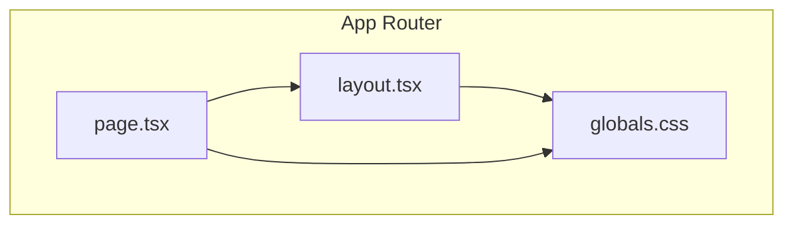
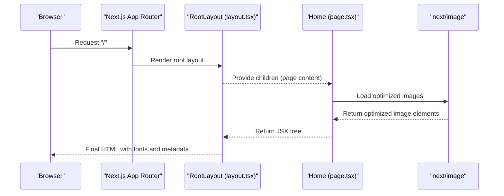
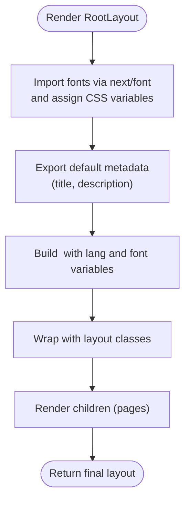
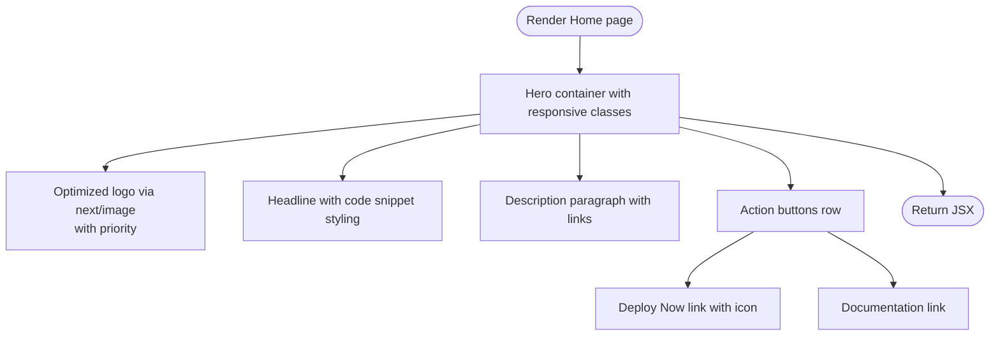
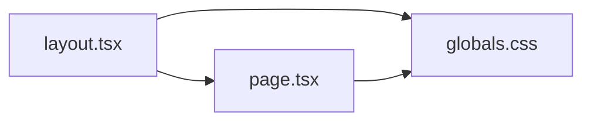
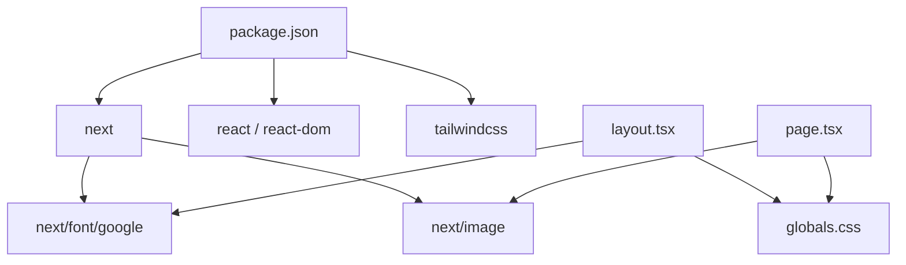

# Core Components

<cite>
**Referenced Files in This Document**
- [layout.tsx](file://frontend/app/layout.tsx)
- [page.tsx](file://frontend/app/page.tsx)
- [globals.css](file://frontend/app/globals.css)
- [README.md](file://frontend/README.md)
- [package.json](file://frontend/package.json)
</cite>

## Table of Contents
1. [Introduction](#introduction)
2. [Project Structure](#project-structure)
3. [Core Components](#core-components)
4. [Architecture Overview](#architecture-overview)
5. [Detailed Component Analysis](#detailed-component-analysis)
6. [Dependency Analysis](#dependency-analysis)
7. [Performance Considerations](#performance-considerations)
8. [Troubleshooting Guide](#troubleshooting-guide)
9. [Conclusion](#conclusion)

## Introduction
This document explains the core React components that power the landing page application built with Next.js App Router. It focuses on:
- The Root Layout Component (layout.tsx), which defines global HTML structure, font configuration via next/font, SEO metadata, and wraps all pages.
- The Home Page Component (page.tsx), which implements the main landing page with responsive design, image optimization using Next.js Image, and dark mode support.
It also covers component composition patterns, prop passing, how these components interact within the App Router, and guidance for extending or modifying them.

## Project Structure
The relevant files for this documentation are located under the app directory:
- app/layout.tsx: Root layout that wraps every route.
- app/page.tsx: Default route (home page).
- app/globals.css: Global styles used by layout and page.

**Diagram sources**
- [layout.tsx:1-30](file://frontend/app/layout.tsx#L1-L30)
- [page.tsx:1-70](file://frontend/app/page.tsx#L1-L70)
- [globals.css](file://frontend/app/globals.css)

**Section sources**
- [layout.tsx:1-30](file://frontend/app/layout.tsx#L1-L30)
- [page.tsx:1-70](file://frontend/app/page.tsx#L1-L70)
- [README.md:1-37](file://frontend/README.md#L1-L37)

## Core Components
- Root Layout (layout.tsx): Provides the top-level <html> and <body>, configures fonts with next/font, sets default metadata for SEO, and applies global CSS.
- Home Page (page.tsx): Renders the landing page content, uses responsive Tailwind classes, optimizes images with next/image, and supports dark mode through Tailwind’s dark variant.

Key responsibilities:
- layout.tsx
  - Define global HTML attributes (lang, class names).
  - Configure Google fonts (Geist Sans and Mono) via next/font.
  - Export metadata for title and description.
  - Wrap children (pages) inside body.
- page.tsx
  - Render a centered hero section with logo, headline, description, and action links.
  - Use next/image to optimize static assets.
  - Apply responsive design and dark mode styling.

**Section sources**
- [layout.tsx:1-30](file://frontend/app/layout.tsx#L1-L30)
- [page.tsx:1-70](file://frontend/app/page.tsx#L1-L70)

## Architecture Overview
The App Router composes the root layout around each page. The home page is rendered as the default route at /.

**Diagram sources**
- [layout.tsx:15-29](file://frontend/app/layout.tsx#L15-L29)
- [page.tsx:1-70](file://frontend/app/page.tsx#L1-L70)

## Detailed Component Analysis

### Root Layout Component (layout.tsx)
Purpose:
- Establishes the global HTML shell and typography variables.
- Sets default SEO metadata.
- Applies global CSS and ensures full-height layout.

Highlights:
- Fonts: Uses next/font/google to import Geist Sans and Geist Mono, exposing CSS variables for use throughout the app.
- Metadata: Exports a Metadata object with title and description for SEO.
- HTML/BODY: Adds lang attribute, applies font variables and utility classes for full height and antialiased text.
- Children: Wraps all routes/pages inside <body>.

Extending or modifying:
- Add more fonts by importing additional families from next/font/google and assigning CSS variables.
- Update metadata per route by exporting route-specific metadata in page-level files.
- Introduce theme providers or context by wrapping children here.

**Diagram sources**
- [layout.tsx:1-30](file://frontend/app/layout.tsx#L1-L30)

**Section sources**
- [layout.tsx:1-30](file://frontend/app/layout.tsx#L1-L30)

### Home Page Component (page.tsx)
Purpose:
- Implements the landing page UI with a hero section, call-to-action links, and optimized images.

Highlights:
- Responsive Design: Uses Tailwind classes to adapt layout across screen sizes (e.g., centering on small screens, left alignment on larger screens).
- Dark Mode Support: Leverages Tailwind’s dark: variants for colors and invert effects on images.
- Image Optimization: Uses next/image with explicit width/height and priority for critical images to improve performance.
- Accessibility: Includes alt attributes for images and semantic headings.

Component Composition Patterns:
- Functional component approach with no hooks in this file; pure presentational component.
- Composition via nested divs and anchor elements; props are not used since it renders static content.

Extending or modifying:
- Replace placeholder content with your brand copy and links.
- Swap images by updating src paths and adjusting width/height accordingly.
- Extend layout sections by adding new blocks following the existing responsive pattern.

**Diagram sources**
- [page.tsx:1-70](file://frontend/app/page.tsx#L1-L70)

**Section sources**
- [page.tsx:1-70](file://frontend/app/page.tsx#L1-L70)

### Conceptual Overview
The layout and page components follow a simple composition model:
- layout.tsx provides the global shell and shared resources (fonts, metadata, global styles).
- page.tsx composes the user-facing content using reusable UI primitives (divs, anchors, images).
- Both leverage Tailwind CSS for styling and dark mode, and next/image for performance.

[No sources needed since this diagram shows conceptual workflow, not actual code structure]

## Dependency Analysis
- Runtime dependencies:
  - next: Provides App Router, next/font, next/image, and build-time optimizations.
  - react/react-dom: Rendering engine.
- Styling:
  - tailwindcss: Utility-first CSS framework enabling responsive and dark-mode classes.
- Fonts:
  - next/font/google: Optimized loading of Google fonts (Geist family).

**Diagram sources**
- [package.json:1-27](file://frontend/package.json#L1-L27)
- [layout.tsx:1-30](file://frontend/app/layout.tsx#L1-L30)
- [page.tsx:1-70](file://frontend/app/page.tsx#L1-L70)
- [globals.css](file://frontend/app/globals.css)

**Section sources**
- [package.json:1-27](file://frontend/package.json#L1-L27)
- [layout.tsx:1-30](file://frontend/app/layout.tsx#L1-L30)
- [page.tsx:1-70](file://frontend/app/page.tsx#L1-L70)

## Performance Considerations
- Font Loading: Using next/font reduces layout shift and improves perceived performance by preloading and optimizing font files.
- Image Optimization: next/image automatically serves appropriately sized images, lazy loads offscreen images, and supports priority for above-the-fold assets.
- Responsive Styles: Tailwind’s utility classes minimize custom CSS and reduce bundle size.
- Dark Mode: Leveraging Tailwind’s dark variant avoids extra runtime logic for theme toggling.

[No sources needed since this section provides general guidance]

## Troubleshooting Guide
- Fonts not applied:
  - Ensure next/font imports are present and CSS variables are attached to html/body classes.
  - Verify globals.css is imported in layout.tsx.
- Images appear blurry or oversized:
  - Confirm width and height are set for next/image and match the intended display size.
  - Check that src points to valid public assets.
- Dark mode styles not visible:
  - Ensure Tailwind dark mode is configured and dark: variants are used consistently.
  - Confirm the root html/body includes appropriate classes if a manual toggle is implemented elsewhere.
- SEO metadata not reflected:
  - Verify metadata is exported from layout.tsx or route-specific files.
  - Inspect the page source to confirm title and description are present.

**Section sources**
- [layout.tsx:1-30](file://frontend/app/layout.tsx#L1-L30)
- [page.tsx:1-70](file://frontend/app/page.tsx#L1-L70)

## Conclusion
The Root Layout and Home Page components form the foundation of the landing page application. The layout establishes global structure, fonts, and metadata, while the page delivers a responsive, accessible, and performant user interface. By following the patterns outlined here—composing functional components, leveraging next/font and next/image, and applying Tailwind utilities—you can extend and customize the landing page effectively.