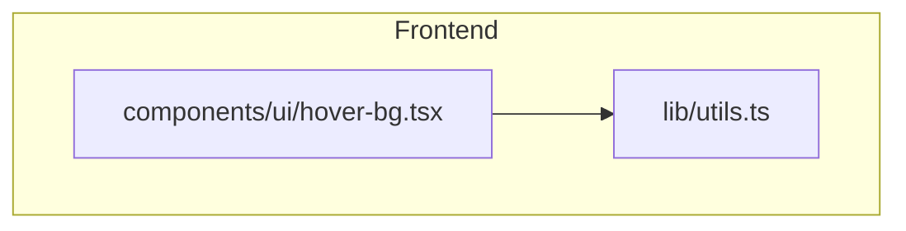
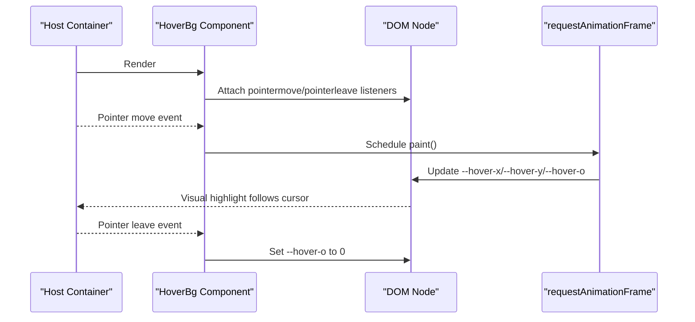
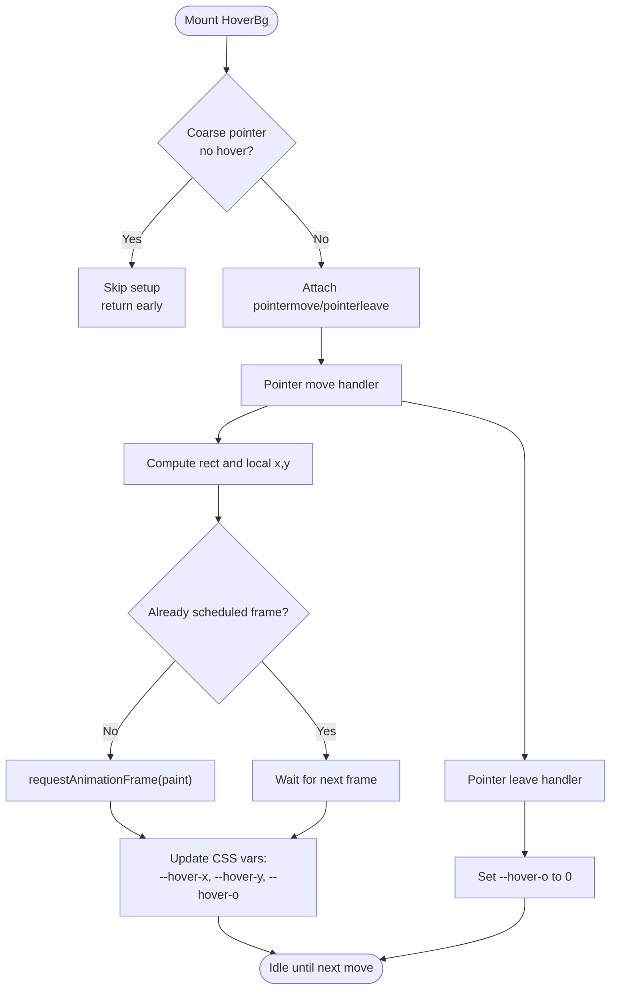
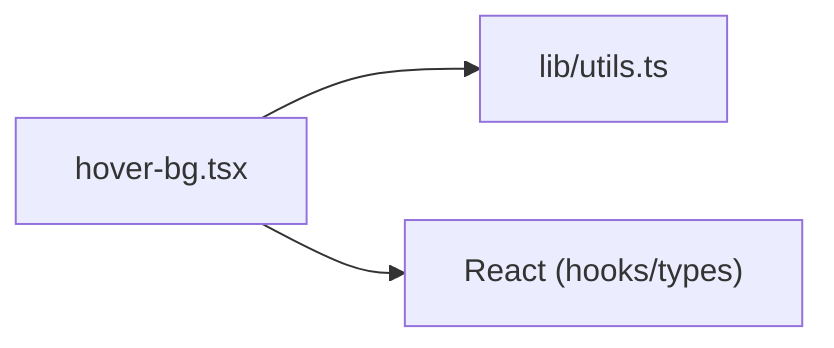

# Hover Background Component

<cite>
**Referenced Files in This Document**
- [hover-bg.tsx](file://frontend/components/ui/hover-bg.tsx)
- [utils.ts](file://frontend/lib/utils.ts)
</cite>

## Table of Contents
1. [Introduction](#introduction)
2. [Project Structure](#project-structure)
3. [Core Components](#core-components)
4. [Architecture Overview](#architecture-overview)
5. [Detailed Component Analysis](#detailed-component-analysis)
6. [Dependency Analysis](#dependency-analysis)
7. [Performance Considerations](#performance-considerations)
8. [Troubleshooting Guide](#troubleshooting-guide)
9. [Conclusion](#conclusion)

## Introduction
This document explains the Hover Background component, a client-side visual effect that highlights a subtle grid and warm radial wash around the cursor within its host container. It is designed to be decorative: it does not capture pointer events, remains hidden on touch-only devices, and uses CSS custom properties to animate the spotlight position smoothly.

## Project Structure
The Hover Background component lives under the UI components directory and depends on a small utility for class merging.

**Diagram sources**
- [hover-bg.tsx:1-70](file://frontend/components/ui/hover-bg.tsx#L1-L70)
- [utils.ts:1-7](file://frontend/lib/utils.ts#L1-L7)

**Section sources**
- [hover-bg.tsx:1-70](file://frontend/components/ui/hover-bg.tsx#L1-L70)
- [utils.ts:1-7](file://frontend/lib/utils.ts#L1-L7)

## Core Components
- HoverBg: A React client component that renders an absolutely positioned overlay with two layered backgrounds:
  - A hairline grid masked by a radial gradient centered at the current pointer coordinates.
  - A warm radial wash that fades in as the pointer moves inside the host container.
- Utility cn: A helper that merges Tailwind classes safely using clsx and tailwind-merge.

Key behaviors:
- Client-only rendering via "use client".
- Pointer tracking updates CSS variables --hover-x, --hover-y, and --hover-o.
- Touch-only environments are skipped automatically using a media query check.
- The overlay is non-interactive (pointer-events-none) and visually hidden until the pointer enters.

**Section sources**
- [hover-bg.tsx:1-70](file://frontend/components/ui/hover-bg.tsx#L1-L70)
- [utils.ts:1-7](file://frontend/lib/utils.ts#L1-L7)

## Architecture Overview
HoverBg integrates into any parent container by being placed inside it. It listens to pointer events on the host element and updates CSS variables that drive the visual effects.

**Diagram sources**
- [hover-bg.tsx:15-56](file://frontend/components/ui/hover-bg.tsx#L15-L56)

## Detailed Component Analysis

### HoverBg Component
Responsibilities:
- Provide a non-interactive backdrop layer with a grid and radial wash.
- Track pointer movement relative to the host container.
- Expose CSS variables for styling the spotlight position and opacity.
- Ensure graceful behavior on touch devices and when the pointer leaves the host.

Implementation highlights:
- Uses a ref to access the overlay node and reads the host element’s bounding rectangle for coordinate calculations.
- Debounces painting through requestAnimationFrame to avoid layout thrashing.
- Applies Tailwind classes and inline styles to create the grid background and radial mask/wash.
- Cleans up event listeners and animation frames on unmount.

**Diagram sources**
- [hover-bg.tsx:15-56](file://frontend/components/ui/hover-bg.tsx#L15-L56)

Props and usage:
- Props: className (optional) to extend or override default styles.
- Rendering: Place inside a container; ensure the container has sufficient size and stacking context if needed.

Accessibility:
- The overlay is marked aria-hidden="true" since it is purely decorative.

Styling details:
- Grid background created with linear gradients and a radial mask.
- Warm radial wash applied as a second background layer with reduced opacity.
- Opacity controlled by --hover-o for smooth fade-in/out transitions.

**Section sources**
- [hover-bg.tsx:1-70](file://frontend/components/ui/hover-bg.tsx#L1-L70)

### Utility cn
Purpose:
- Safely merge multiple class inputs into a single string, resolving conflicts and applying Tailwind utilities correctly.

Usage:
- Imported by HoverBg to compose className props and internal classes.

**Section sources**
- [utils.ts:1-7](file://frontend/lib/utils.ts#L1-L7)

## Dependency Analysis
HoverBg has minimal dependencies:
- React hooks: useEffect, useRef, CSSProperties.
- Utility function: cn from lib/utils.

**Diagram sources**
- [hover-bg.tsx:1-10](file://frontend/components/ui/hover-bg.tsx#L1-L10)
- [utils.ts:1-7](file://frontend/lib/utils.ts#L1-L7)

**Section sources**
- [hover-bg.tsx:1-10](file://frontend/components/ui/hover-bg.tsx#L1-L10)
- [utils.ts:1-7](file://frontend/lib/utils.ts#L1-L7)

## Performance Considerations
- Animation loop: Painting is throttled via requestAnimationFrame to prevent excessive reflows.
- Event handling: Only pointermove and pointerleave are used; no heavy computations inside handlers.
- CSS-driven visuals: Most effects are handled by the browser compositor using CSS variables and gradients.
- Touch optimization: Early exit on coarse pointers avoids unnecessary work on mobile/touch devices.

Recommendations:
- Keep the host container reasonably sized to limit repaint areas.
- Avoid placing many overlapping HoverBg instances in the same viewport without necessity.
- Ensure the host container is not frequently resized during interaction to minimize getBoundingClientRect calls.

[No sources needed since this section provides general guidance]

## Troubleshooting Guide
Symptoms and resolutions:
- Spotlight does not appear:
  - Verify the component is rendered inside a visible host container.
  - Confirm the environment supports hover and fine pointer input; touch-only devices intentionally skip the effect.
- Highlight lags or flickers:
  - Ensure the host container is not being rapidly resized or scrolled while interacting.
  - Check for other heavy animations competing for the main thread.
- Styles not applied:
  - Confirm Tailwind classes and CSS variables are available in the build pipeline.
  - Validate that the cn utility is correctly merging classes.

Debugging tips:
- Inspect CSS variables --hover-x, --hover-y, and --hover-o on the overlay node to verify updates.
- Temporarily log pointer coordinates in the move handler to confirm event delivery.

**Section sources**
- [hover-bg.tsx:15-56](file://frontend/components/ui/hover-bg.tsx#L15-L56)

## Conclusion
The Hover Background component delivers a lightweight, composable visual enhancement that reacts to pointer movement within its host container. It leverages CSS variables and requestAnimationFrame for smooth performance, respects touch-only environments, and remains fully accessible as a decorative element. Its minimal dependency footprint makes it easy to integrate across pages and sections.

[No sources needed since this section summarizes without analyzing specific files]