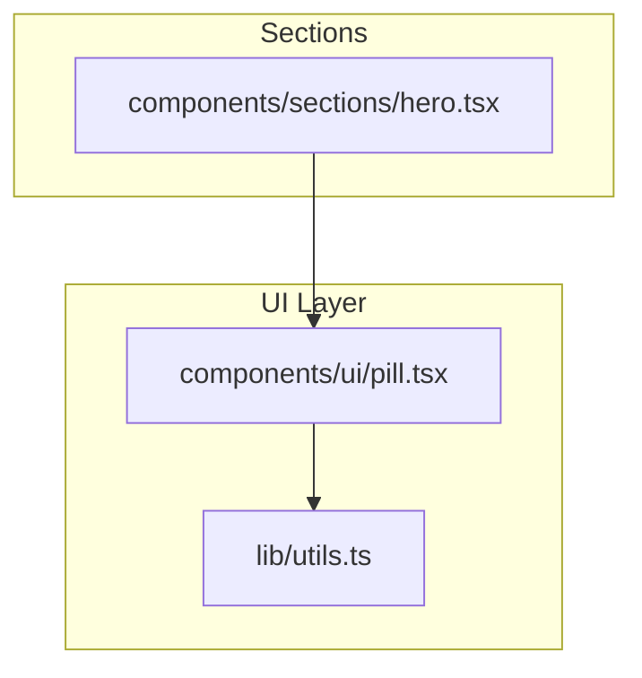
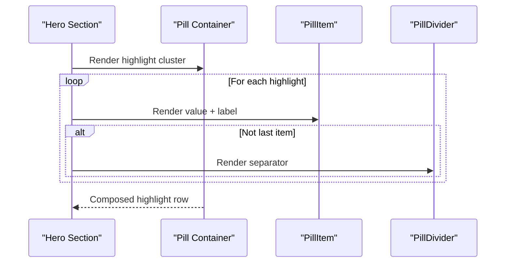
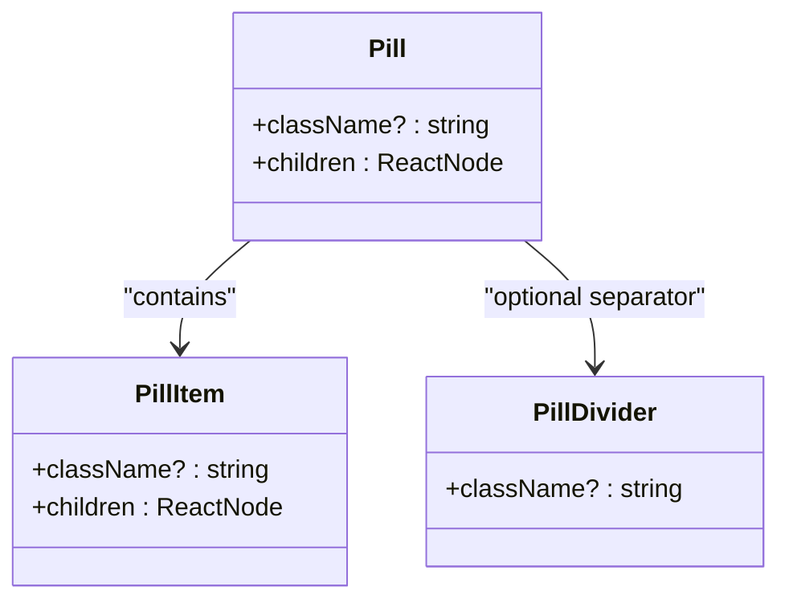
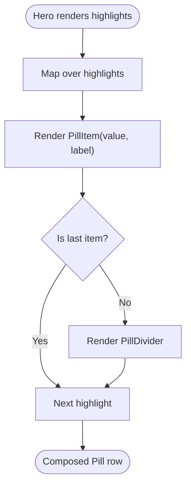
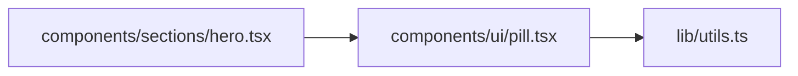

# Pill Components

<cite>
**Referenced Files in This Document**
- [pill.tsx](file://frontend/components/ui/pill.tsx)
- [hero.tsx](file://frontend/components/sections/hero.tsx)
- [utils.ts](file://frontend/lib/utils.ts)
</cite>

## Table of Contents
1. [Introduction](#introduction)
2. [Project Structure](#project-structure)
3. [Core Components](#core-components)
4. [Architecture Overview](#architecture-overview)
5. [Detailed Component Analysis](#detailed-component-analysis)
6. [Dependency Analysis](#dependency-analysis)
7. [Performance Considerations](#performance-considerations)
8. [Troubleshooting Guide](#troubleshooting-guide)
9. [Conclusion](#conclusion)

## Introduction
This document explains the Pill components used across the frontend application. The Pill system provides a compact, rounded container for short label clusters (such as metric highlights), with consistent styling and accessible composition through dedicated item and divider elements. It is primarily used in the Hero section to display key product highlights.

## Project Structure
The Pill components live under the shared UI layer and are consumed by page sections:

**Diagram sources**
- [pill.tsx:1-43](file://frontend/components/ui/pill.tsx#L1-L43)
- [hero.tsx:10-110](file://frontend/components/sections/hero.tsx#L10-L110)
- [utils.ts:1-7](file://frontend/lib/utils.ts#L1-L7)

**Section sources**
- [pill.tsx:1-43](file://frontend/components/ui/pill.tsx#L1-L43)
- [hero.tsx:1-180](file://frontend/components/sections/hero.tsx#L1-L180)
- [utils.ts:1-7](file://frontend/lib/utils.ts#L1-L7)

## Core Components
The Pill system consists of three cooperating components:

- Pill
  - Purpose: A rounded, hairline-bordered container that groups related labels or metrics.
  - Props: Accepts all standard HTML div attributes via React’s type-safe props; supports className override.
  - Styling: Uses a utility function to merge Tailwind classes and applies a consistent base style.

- PillItem
  - Purpose: Represents a single entry inside a Pill, pairing a value with its label.
  - Props: Accepts all standard HTML span attributes; supports className override.
  - Styling: Provides consistent spacing, typography, and muted text color.

- PillDivider
  - Purpose: A vertical separator between PillItem entries.
  - Props: Accepts className override; visually hidden from assistive technology.
  - Styling: Renders a thin vertical line using border color tokens.

Styling approach:
- All components use a class-name merging utility to compose base styles with optional overrides.

Accessibility:
- PillDivider uses aria-hidden to avoid exposing decorative separators to screen readers.

**Section sources**
- [pill.tsx:5-19](file://frontend/components/ui/pill.tsx#L5-L19)
- [pill.tsx:21-32](file://frontend/components/ui/pill.tsx#L21-L32)
- [pill.tsx:34-42](file://frontend/components/ui/pill.tsx#L34-L42)
- [utils.ts:4-6](file://frontend/lib/utils.ts#L4-L6)

## Architecture Overview
The Pill components are presented within the Hero section to showcase product highlights. The Hero composes multiple PillItems and divides them with PillDivider, then wraps them in a Pill container. On small screens, the same content is duplicated into a marquee row for horizontal scrolling.

**Diagram sources**
- [hero.tsx:18-38](file://frontend/components/sections/hero.tsx#L18-L38)
- [hero.tsx:108-110](file://frontend/components/sections/hero.tsx#L108-L110)
- [pill.tsx:9-19](file://frontend/components/ui/pill.tsx#L9-L19)
- [pill.tsx:22-32](file://frontend/components/ui/pill.tsx#L22-L32)
- [pill.tsx:35-42](file://frontend/components/ui/pill.tsx#L35-L42)

## Detailed Component Analysis

### Pill Container
- Role: Groups related items into a cohesive visual unit.
- Composition: Wraps one or more PillItem components and optional PillDivider components.
- Styling: Applies a rounded full shape, subtle border, background token, padding, and shadow.
- Extensibility: Accepts className to customize layout or appearance when needed.

**Diagram sources**
- [pill.tsx:9-19](file://frontend/components/ui/pill.tsx#L9-L19)
- [pill.tsx:22-32](file://frontend/components/ui/pill.tsx#L22-L32)
- [pill.tsx:35-42](file://frontend/components/ui/pill.tsx#L35-L42)

**Section sources**
- [pill.tsx:9-19](file://frontend/components/ui/pill.tsx#L9-L19)

### PillItem
- Role: Displays a paired value and label with consistent spacing and typography.
- Usage: One instance per highlight; typically followed by a PillDivider unless it is the last item.
- Styling: Muted foreground color, responsive font sizes, and internal spacing.

**Section sources**
- [pill.tsx:22-32](file://frontend/components/ui/pill.tsx#L22-L32)

### PillDivider
- Role: Provides a vertical separator between items.
- Accessibility: Decorative element marked aria-hidden.
- Styling: Thin vertical line using border color tokens.

**Section sources**
- [pill.tsx:35-42](file://frontend/components/ui/pill.tsx#L35-L42)

### Hero Integration
- Data source: A small array of highlight objects defines values and labels.
- Rendering logic: Maps over highlights to render PillItem pairs, inserting PillDivider between items.
- Responsive behavior:
  - Mobile: Renders a horizontally scrollable marquee with duplicated content.
  - Tablet/desktop: Renders a single centered Pill row.

**Diagram sources**
- [hero.tsx:18-38](file://frontend/components/sections/hero.tsx#L18-L38)
- [hero.tsx:108-110](file://frontend/components/sections/hero.tsx#L108-L110)

**Section sources**
- [hero.tsx:18-38](file://frontend/components/sections/hero.tsx#L18-L38)
- [hero.tsx:108-110](file://frontend/components/sections/hero.tsx#L108-L110)

## Dependency Analysis
- Pill components depend on a class-name merging utility to combine base styles with user-provided overrides.
- The Hero section imports and composes Pill, PillItem, and PillDivider to present highlight data.

**Diagram sources**
- [hero.tsx:10-11](file://frontend/components/sections/hero.tsx#L10-L11)
- [pill.tsx:3-3](file://frontend/components/ui/pill.tsx#L3-L3)
- [utils.ts:4-6](file://frontend/lib/utils.ts#L4-L6)

**Section sources**
- [hero.tsx:10-11](file://frontend/components/sections/hero.tsx#L10-L11)
- [pill.tsx:3-3](file://frontend/components/ui/pill.tsx#L3-L3)
- [utils.ts:4-6](file://frontend/lib/utils.ts#L4-L6)

## Performance Considerations
- Lightweight primitives: Pill, PillItem, and PillDivider are minimal DOM nodes with no heavy state or side effects.
- Class merging: Using a utility to merge Tailwind classes avoids redundant style computations and keeps CSS output predictable.
- Motion integration: In the Hero section, motion animations wrap the Pill row but do not affect the Pill components themselves.

[No sources needed since this section provides general guidance]

## Troubleshooting Guide
- Overlapping or misaligned items:
  - Ensure each highlight is wrapped in a PillItem and separated by PillDivider where appropriate.
  - Verify that the parent Pill has sufficient width and wrapping behavior for the number of items.
- Text truncation or overflow:
  - Confirm that the container allows wrapping or horizontal scrolling on mobile if many items are present.
- Styling conflicts:
  - Use className overrides sparingly and rely on the class-name merging utility to prevent conflicting Tailwind rules.
- Accessibility:
  - Avoid adding interactive children to PillDivider; it should remain a decorative separator.

**Section sources**
- [pill.tsx:9-19](file://frontend/components/ui/pill.tsx#L9-L19)
- [pill.tsx:22-32](file://frontend/components/ui/pill.tsx#L22-L32)
- [pill.tsx:35-42](file://frontend/components/ui/pill.tsx#L35-L42)
- [hero.tsx:95-110](file://frontend/components/sections/hero.tsx#L95-L110)

## Conclusion
The Pill component family offers a simple, composable way to present short label clusters with consistent styling and accessibility. By combining Pill, PillItem, and PillDivider, the Hero section cleanly displays product highlights across devices. The design leverages a class-name merging utility for flexible styling while keeping the components lightweight and easy to extend.

[No sources needed since this section summarizes without analyzing specific files]