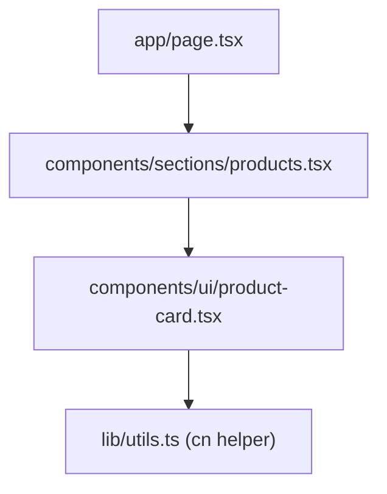
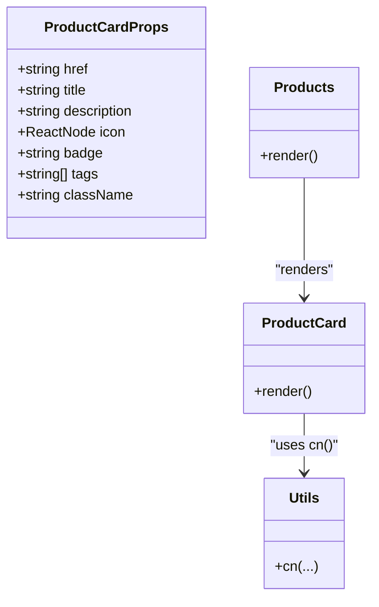
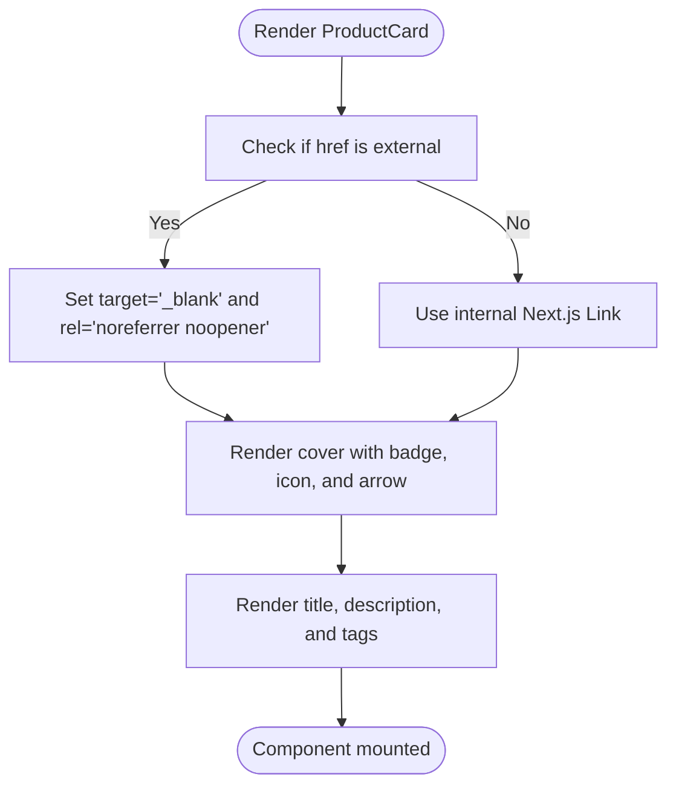
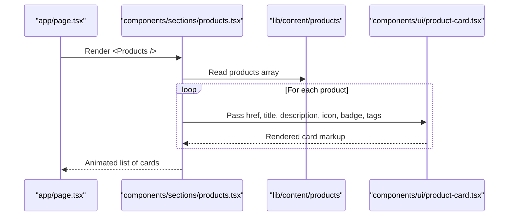
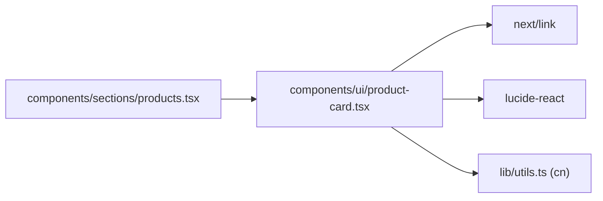

# Product Card Component

<cite>
**Referenced Files in This Document**
- [product-card.tsx](file://frontend/components/ui/product-card.tsx)
- [products.tsx](file://frontend/components/sections/products.tsx)
- [page.tsx](file://frontend/app/page.tsx)
- [utils.ts](file://frontend/lib/utils.ts)
</cite>

## Table of Contents
1. [Introduction](#introduction)
2. [Project Structure](#project-structure)
3. [Core Components](#core-components)
4. [Architecture Overview](#architecture-overview)
5. [Detailed Component Analysis](#detailed-component-analysis)
6. [Dependency Analysis](#dependency-analysis)
7. [Performance Considerations](#performance-considerations)
8. [Troubleshooting Guide](#troubleshooting-guide)
9. [Conclusion](#conclusion)

## Introduction
This document explains the Product Card component used to display product entries on the landing page. It covers how the component is structured, its props and behavior, where it is used, and how it integrates with the rest of the application. The goal is to make the component easy to understand, extend, and troubleshoot for both developers and non-technical readers.

## Project Structure
The Product Card lives under the UI components folder and is consumed by the Products section, which is rendered from the root page.

**Diagram sources**
- [page.tsx:10-23](file://frontend/app/page.tsx#L10-L23)
- [products.tsx:13-76](file://frontend/components/sections/products.tsx#L13-L76)
- [product-card.tsx:25-109](file://frontend/components/ui/product-card.tsx#L25-L109)
- [utils.ts:4-6](file://frontend/lib/utils.ts#L4-L6)

**Section sources**
- [page.tsx:10-23](file://frontend/app/page.tsx#L10-L23)
- [products.tsx:13-76](file://frontend/components/sections/products.tsx#L13-L76)
- [product-card.tsx:25-109](file://frontend/components/ui/product-card.tsx#L25-L109)
- [utils.ts:4-6](file://frontend/lib/utils.ts#L4-L6)

## Core Components
- ProductCard: A reusable card that renders a linkable surface with a cover area, optional badge, icon, title, description, and tags. It supports external links and accessibility attributes.
- Products section: Renders a grid of ProductCard instances using data from a content file and adds motion animations.

Key responsibilities:
- ProductCard encapsulates visual styling, hover/focus states, and link behavior.
- Products orchestrates layout, animation, and data binding for multiple cards.

**Section sources**
- [product-card.tsx:12-109](file://frontend/components/ui/product-card.tsx#L12-L109)
- [products.tsx:13-76](file://frontend/components/sections/products.tsx#L13-L76)

## Architecture Overview
The Product Card is a presentational component. It receives all necessary data via props and delegates navigation to Next.js Link. Styling is composed with Tailwind classes and merged through a utility function.

**Diagram sources**
- [product-card.tsx:12-109](file://frontend/components/ui/product-card.tsx#L12-L109)
- [products.tsx:13-76](file://frontend/components/sections/products.tsx#L13-L76)
- [utils.ts:4-6](file://frontend/lib/utils.ts#L4-L6)

## Detailed Component Analysis

### ProductCard Component
ProductCard is a functional React component that renders a styled link with a cover area and metadata.

- Props
  - href: Destination URL; if it starts with http(s), the link opens in a new tab with safe rel attributes.
  - title: Displayed as the card heading.
  - description: Optional descriptive text shown below the title.
  - icon: Any React node displayed in the center of the cover.
  - badge: Optional small label in the top-left corner of the cover.
  - tags: Array of strings rendered as chips under the description.
  - className: Additional classes to customize the root element.

- Behavior
  - External link detection: Automatically sets target and rel for safety when href is an absolute URL.
  - Accessibility: Uses semantic headings and aria-hidden for decorative elements.
  - Visual feedback: Hover and focus-visible states improve interactivity.
  - Composition: Uses a utility function to merge Tailwind classes safely.

**Diagram sources**
- [product-card.tsx:34-44](file://frontend/components/ui/product-card.tsx#L34-L44)
- [product-card.tsx:63-80](file://frontend/components/ui/product-card.tsx#L63-L80)
- [product-card.tsx:83-105](file://frontend/components/ui/product-card.tsx#L83-L105)

**Section sources**
- [product-card.tsx:12-109](file://frontend/components/ui/product-card.tsx#L12-L109)

### Products Section Integration
The Products section maps over a products dataset and renders one ProductCard per item. It also provides a fallback href when a product URL is missing.

- Data binding
  - Each product supplies id, name, description, url, and highlights.
  - The index is converted into a zero-padded badge string.
  - Icons are provided via a separate ProductIcon component.

- Animation
  - Framer Motion animates container and items with staggered transitions.
  - Respects user preference for reduced motion.

**Diagram sources**
- [page.tsx:10-23](file://frontend/app/page.tsx#L10-L23)
- [products.tsx:13-76](file://frontend/components/sections/products.tsx#L13-L76)
- [product-card.tsx:25-109](file://frontend/components/ui/product-card.tsx#L25-L109)

**Section sources**
- [products.tsx:13-76](file://frontend/components/sections/products.tsx#L13-L76)

## Dependency Analysis
- Internal dependencies
  - ProductCard depends on:
    - Next.js Link for navigation
    - Lucide React icons for the open-arrow indicator
    - lib/utils.ts cn helper for class merging
- Consumers
  - Products section imports ProductCard and composes it with motion and data.

**Diagram sources**
- [products.tsx:1-11](file://frontend/components/sections/products.tsx#L1-L11)
- [product-card.tsx:1-5](file://frontend/components/ui/product-card.tsx#L1-L5)
- [utils.ts:1-6](file://frontend/lib/utils.ts#L1-L6)

**Section sources**
- [products.tsx:1-11](file://frontend/components/sections/products.tsx#L1-L11)
- [product-card.tsx:1-5](file://frontend/components/ui/product-card.tsx#L1-L5)
- [utils.ts:1-6](file://frontend/lib/utils.ts#L1-L6)

## Performance Considerations
- Client-side rendering
  - The Products section is a client component due to motion; this enables animations but increases initial JS payload.
- Reduced motion
  - The section respects user preferences to minimize motion, improving performance and comfort for sensitive users.
- Class merging
  - Using the cn helper prevents duplicate or conflicting Tailwind classes, keeping CSS output lean.
- Link handling
  - External links use target and rel attributes to avoid unnecessary reflows and maintain security.

[No sources needed since this section provides general guidance]

## Troubleshooting Guide
- Links not opening externally
  - Ensure href values for external destinations start with http:// or https:// so the component detects them correctly.
- Missing or empty tags
  - If tags are undefined or empty, the tag list will not render; pass an array of strings to display chips.
- Badge not visible
  - Provide a badge prop; otherwise, the top-left badge is omitted.
- Styles not applying
  - Verify that Tailwind is configured and that the cn helper is available at the expected path.
- Animations causing jank
  - Users can reduce motion; the section adapts automatically. If you add more animations, respect reduced motion.

**Section sources**
- [product-card.tsx:34-44](file://frontend/components/ui/product-card.tsx#L34-L44)
- [product-card.tsx:63-105](file://frontend/components/ui/product-card.tsx#L63-L105)
- [products.tsx:13-37](file://frontend/components/sections/products.tsx#L13-L37)

## Conclusion
The Product Card component provides a clean, accessible, and customizable surface for showcasing products. It integrates seamlessly with the Products section, which handles data mapping, layout, and motion. By following the documented props and behaviors, you can reliably extend or adapt the card for additional use cases while maintaining consistent styling and interaction patterns.