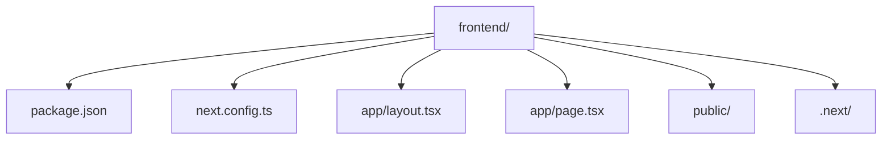
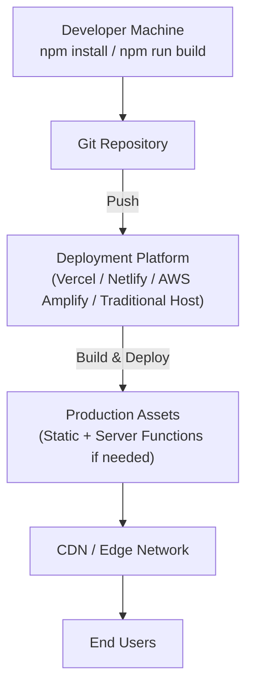
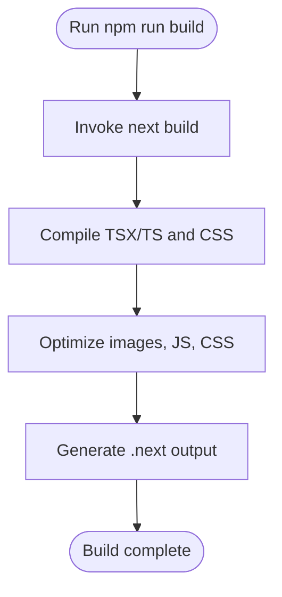
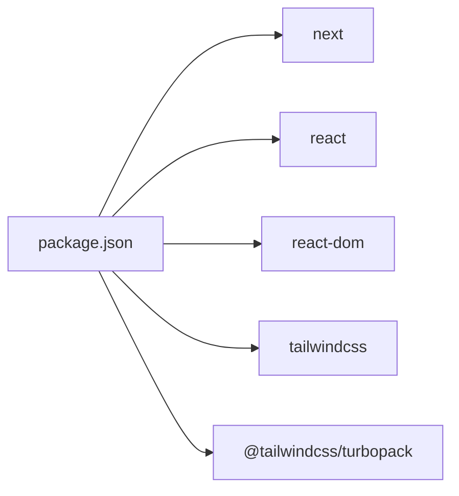

# Deployment Guide

<cite>
**Referenced Files in This Document**
- [package.json](file://frontend/package.json)
- [next.config.ts](file://frontend/next.config.ts)
- [README.md](file://frontend/README.md)
- [app/layout.tsx](file://frontend/app/layout.tsx)
- [app/page.tsx](file://frontend/app/page.tsx)
</cite>

## Table of Contents
1. [Introduction](#introduction)
2. [Project Structure](#project-structure)
3. [Core Components](#core-components)
4. [Architecture Overview](#architecture-overview)
5. [Detailed Component Analysis](#detailed-component-analysis)
6. [Dependency Analysis](#dependency-analysis)
7. [Performance Considerations](#performance-considerations)
8. [Troubleshooting Guide](#troubleshooting-guide)
9. [Conclusion](#conclusion)
10. [Appendices](#appendices)

## Introduction
This guide explains how to build and deploy the Next.js landing page application to production. It covers:
- The production build process using npm run build and what it produces
- Recommended deployment on Vercel, including one-click GitHub integration and environment variables
- Alternative platforms such as Netlify, AWS Amplify, and traditional hosting
- Custom domains, SSL certificates, and CDN configuration
- Environment-specific configurations, performance optimization for production, and monitoring setup
- Troubleshooting common deployment issues and rollback strategies

## Project Structure
The project is a standard Next.js App Router application with TypeScript and Tailwind CSS. Key files relevant to deployment include:
- package.json: defines scripts (dev, build, start), dependencies, and devDependencies
- next.config.ts: Next.js configuration including component caching and Turbopack rules
- app/layout.tsx: root layout and metadata
- app/page.tsx: default page content
- README.md: development instructions and links to deployment resources

**Diagram sources**
- [package.json:1-27](file://frontend/package.json#L1-L27)
- [next.config.ts:1-18](file://frontend/next.config.ts#L1-L18)
- [app/layout.tsx:1-30](file://frontend/app/layout.tsx#L1-L30)
- [app/page.tsx:1-70](file://frontend/app/page.tsx#L1-L70)

**Section sources**
- [package.json:1-27](file://frontend/package.json#L1-L27)
- [next.config.ts:1-18](file://frontend/next.config.ts#L1-L18)
- [README.md:1-37](file://frontend/README.md#L1-L37)

## Core Components
- Build and start scripts are defined in package.json:
  - npm run build triggers the Next.js production build
  - npm run start serves the built output
- Next.js configuration enables optimizations:
  - cacheComponents: true
  - partialPrefetching: true
  - Turbopack rule for CSS processing via @tailwindcss/turbopack
- Root layout sets global fonts and metadata
- Default page uses Next.js Image component and Tailwind classes

**Section sources**
- [package.json:5-10](file://frontend/package.json#L5-L10)
- [next.config.ts:3-15](file://frontend/next.config.ts#L3-L15)
- [app/layout.tsx:15-28](file://frontend/app/layout.tsx#L15-L28)
- [app/page.tsx:1-14](file://frontend/app/page.tsx#L1-L14)

## Architecture Overview
At a high level, the application is a static-capable Next.js site that can be deployed to any platform supporting static assets or Node.js serverless functions. The recommended path is Vercel, which integrates tightly with Next.js features and provides automatic CI/CD, custom domains, SSL, and CDN.

[No sources needed since this diagram shows conceptual workflow, not actual code structure]

## Detailed Component Analysis

### Production Build Process (npm run build)
- What it does: Compiles TypeScript, optimizes assets, generates static pages, and prepares server-side rendering capabilities where applicable.
- Where it’s configured: package.json scripts define "build": "next build".
- Output directory: .next (generated by Next.js). This folder contains optimized bundles, static assets, and runtime artifacts used by the production server.

**Diagram sources**
- [package.json:5-10](file://frontend/package.json#L5-L10)

**Section sources**
- [package.json:5-10](file://frontend/package.json#L5-L10)

### Resulting Output Structure (.next)
- .next: Contains compiled and optimized artifacts for production.
- public/: Static assets served at the root path (e.g., images referenced via absolute paths like "/next.svg").

Note: The exact contents of .next are generated by Next.js and may vary by version and configuration.

**Section sources**
- [app/page.tsx:7-14](file://frontend/app/page.tsx#L7-L14)

### Vercel Deployment (Recommended)
- One-click from GitHub:
  - Connect your repository to Vercel
  - Vercel detects Next.js automatically
  - Configure environment variables in the Vercel dashboard
  - Deployments are triggered on push to main branches; preview deployments work on pull requests
- Environment variables:
  - Set in Vercel > Settings > Environment Variables
  - Available at build time and runtime depending on variable scope
- Custom domain and SSL:
  - Add a custom domain in Vercel Domains settings
  - SSL is automatically provisioned and renewed
- CDN:
  - Vercel serves assets globally via its edge network

**Section sources**
- [README.md:32-36](file://frontend/README.md#L32-L36)

### Netlify Deployment
- Connect repository to Netlify
- Build command: npm run build
- Publish directory: .next
- Environment variables: configure in Netlify UI under Site settings > Environment variables
- Custom domain and SSL: add domain in Netlify and enable automatic HTTPS
- CDN: Netlify serves assets through its global CDN

**Section sources**
- [package.json:5-10](file://frontend/package.json#L5-L10)

### AWS Amplify Deployment
- Connect repository to Amplify Hosting
- Build command: npm run build
- Artifacts directory: .next
- Environment variables: configure in Amplify console
- Custom domain and SSL: set up in Amplify Domain Management; SSL is automated
- CDN: Amplify uses CloudFront for global delivery

**Section sources**
- [package.json:5-10](file://frontend/package.json#L5-L10)

### Traditional Hosting Solutions
- Build locally or in CI: npm run build
- Serve the .next directory with a Node.js server: npm run start
- Reverse proxy (nginx/Caddy/Apache):
  - Proxy to localhost:3000
  - Enable gzip/brotli compression
  - Cache static assets appropriately
- Custom domain and SSL:
  - Obtain certificates (Let’s Encrypt via Certbot or provider-managed)
  - Configure TLS termination at the reverse proxy
- CDN:
  - Place a CDN in front of the origin (Cloudflare, Fastly, etc.)
  - Configure cache rules for static assets and API routes

**Section sources**
- [package.json:5-10](file://frontend/package.json#L5-L10)

### Configuration for Custom Domains, SSL, and CDN
- Vercel:
  - Add domain in Domains settings; SSL is automatic
  - Global CDN is enabled by default
- Netlify:
  - Add domain in Domain management; HTTPS is automatic
  - Global CDN is enabled by default
- AWS Amplify:
  - Use Amplify Domain Management; SSL is automatic
  - Uses CloudFront for CDN
- Traditional hosting:
  - Configure TLS at the reverse proxy
  - Optionally place a CDN in front of the origin

**Section sources**
- [README.md:32-36](file://frontend/README.md#L32-L36)

### Environment-Specific Configurations
- Next.js supports environment variables via .env.local (local), .env.production (production), and platform-specific secret managers.
- For Vercel, set variables in the dashboard; they are injected during build and/or runtime based on variable type.
- For other platforms, follow their environment variable configuration steps.

[No sources needed since this section provides general guidance]

### Performance Optimization for Production
- Next.js configuration:
  - cacheComponents: true
  - partialPrefetching: true
  - Turbopack CSS loader rule for Tailwind
- Asset optimization:
  - Use next/image for image optimization
  - Prefer static assets in public/ for large files
- Caching:
  - Leverage platform CDNs for static asset caching
  - Configure appropriate cache headers for HTML vs. static assets

**Section sources**
- [next.config.ts:3-15](file://frontend/next.config.ts#L3-L15)
- [app/page.tsx:7-14](file://frontend/app/page.tsx#L7-L14)

### Monitoring Setup
- Vercel Analytics:
  - Enable in Vercel dashboard for performance insights
- Third-party analytics:
  - Integrate providers (e.g., Plausible, GA4) via environment variables and client-side scripts
- Error tracking:
  - Use services like Sentry; configure via environment variables

[No sources needed since this section provides general guidance]

## Dependency Analysis
The application depends on Next.js, React, and Tailwind CSS tooling. Scripts and dependencies are declared in package.json.

**Diagram sources**
- [package.json:11-25](file://frontend/package.json#L11-L25)

**Section sources**
- [package.json:11-25](file://frontend/package.json#L11-L25)

## Performance Considerations
- Keep images optimized using next/image and avoid oversized assets.
- Utilize platform CDNs to reduce latency.
- Enable compression at the reverse proxy when self-hosting.
- Monitor bundle sizes and remove unused dependencies.

[No sources needed since this section provides general guidance]

## Troubleshooting Guide
Common issues and resolutions:
- Build fails due to missing dependencies:
  - Ensure npm install runs before npm run build
- Environment variables not available:
  - Verify variables are set in the platform’s environment settings
- Custom domain not resolving:
  - Check DNS records and propagation; ensure SSL provisioning is active
- Static assets not loading:
  - Confirm paths in public/ and usage of absolute paths in components
- Port conflicts on traditional hosting:
  - Change port or stop conflicting processes; update reverse proxy accordingly

**Section sources**
- [package.json:5-10](file://frontend/package.json#L5-L10)
- [app/page.tsx:7-14](file://frontend/app/page.tsx#L7-L14)

## Conclusion
For the fastest and most reliable deployment, use Vercel with one-click GitHub integration, automatic SSL, and global CDN. For other platforms, follow the provided steps to build with npm run build and serve the .next output. Configure environment variables per platform, set up custom domains and SSL, and leverage CDN caching for optimal performance.

[No sources needed since this section summarizes without analyzing specific files]

## Appendices

### Quick Commands
- Install dependencies: npm install
- Development server: npm run dev
- Production build: npm run build
- Start production server: npm run start

**Section sources**
- [package.json:5-10](file://frontend/package.json#L5-L10)