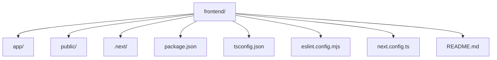
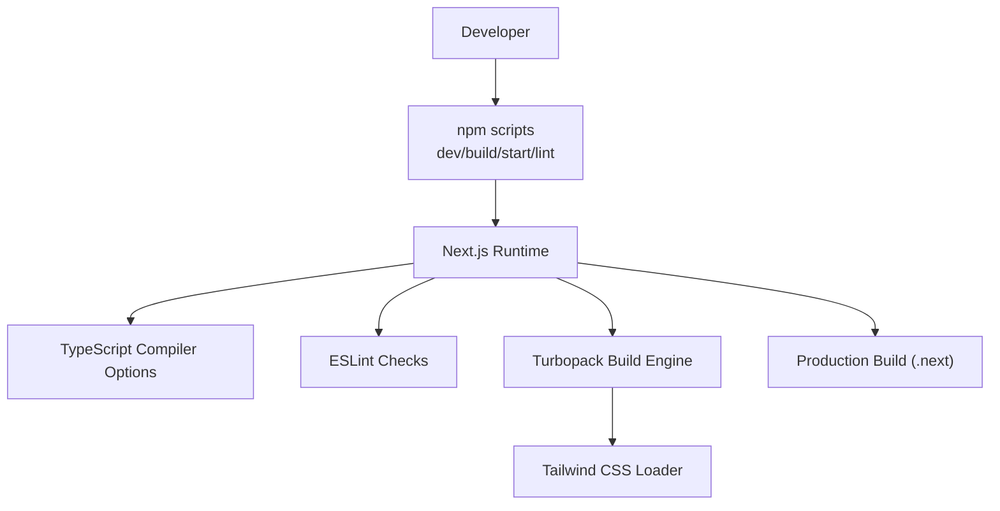
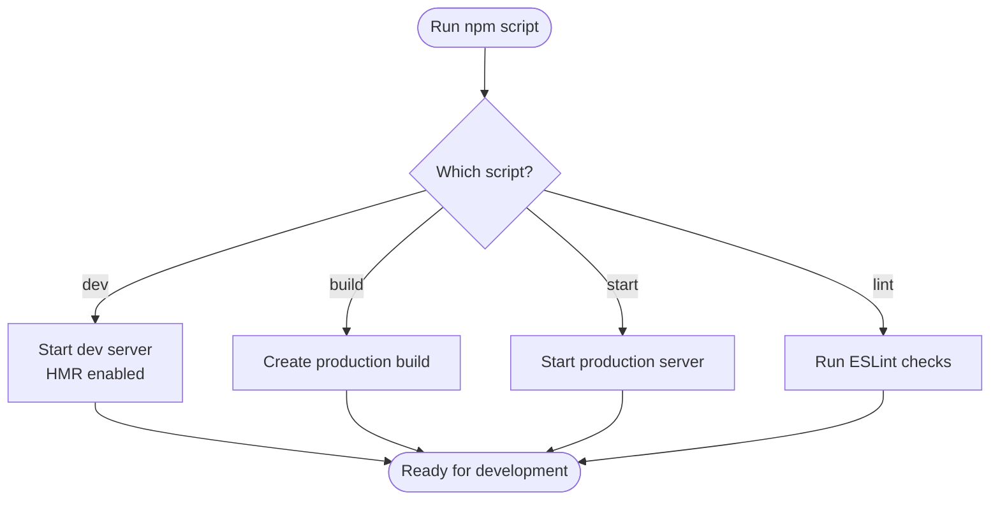
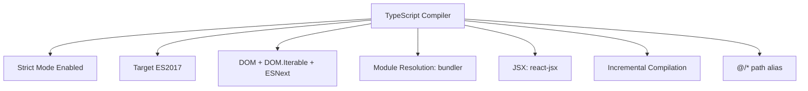
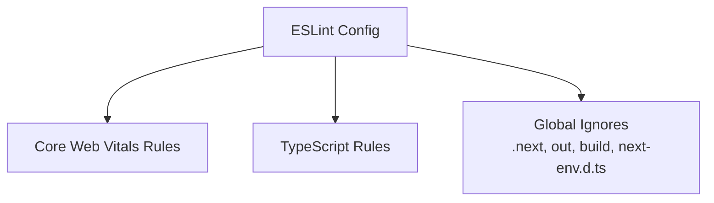
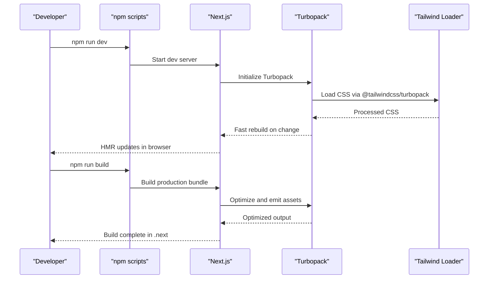
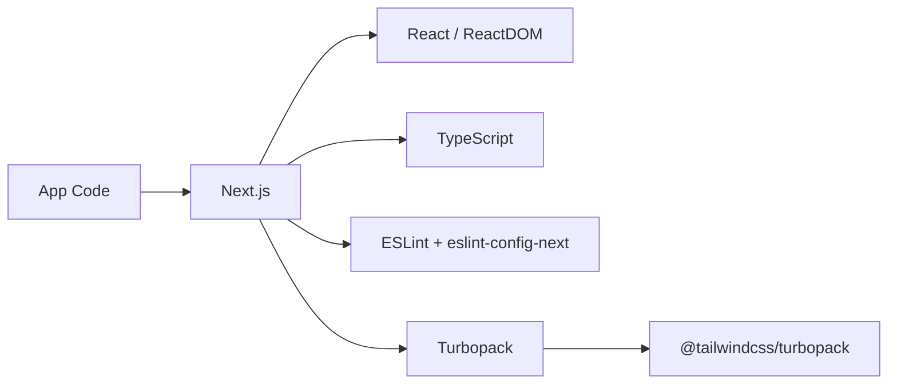

# Development Workflow

<cite>
**Referenced Files in This Document**
- [package.json](file://frontend/package.json)
- [tsconfig.json](file://frontend/tsconfig.json)
- [eslint.config.mjs](file://frontend/eslint.config.mjs)
- [next.config.ts](file://frontend/next.config.ts)
- [README.md](file://frontend/README.md)
</cite>

## Table of Contents
1. [Introduction](#introduction)
2. [Project Structure](#project-structure)
3. [Core Components](#core-components)
4. [Architecture Overview](#architecture-overview)
5. [Detailed Component Analysis](#detailed-component-analysis)
6. [Dependency Analysis](#dependency-analysis)
7. [Performance Considerations](#performance-considerations)
8. [Troubleshooting Guide](#troubleshooting-guide)
9. [Conclusion](#conclusion)

## Introduction
This document explains the development workflow and tooling setup for the Next.js frontend project. It covers available npm scripts, TypeScript configuration with strict mode, ESLint rules, and the build process using Turbopack. It also provides guidelines for writing TypeScript code, following ESLint rules, debugging common issues, and optimizing both development and production experiences.

## Project Structure
The project is a Next.js application with:
- Application source under app/
- Configuration files at the root: package.json, tsconfig.json, eslint.config.mjs, next.config.ts
- Public assets under public/
- Generated artifacts under .next/ (not edited manually)

**Section sources**
- [README.md:1-37](file://frontend/README.md#L1-L37)

## Core Components
- Package scripts define the primary workflows: development server, building, starting the production server, and linting.
- TypeScript is configured with strict mode enabled to improve type safety and catch errors early.
- ESLint uses Next.js recommended configurations for JavaScript/TypeScript and core web vitals.
- Next.js is configured to use Turbopack for faster builds and hot module replacement during development, with Tailwind CSS integration via a custom loader rule.

**Section sources**
- [package.json:5-10](file://frontend/package.json#L5-L10)
- [tsconfig.json:1-35](file://frontend/tsconfig.json#L1-L35)
- [eslint.config.mjs:1-19](file://frontend/eslint.config.mjs#L1-L19)
- [next.config.ts:1-18](file://frontend/next.config.ts#L1-L18)

## Architecture Overview
The development and build pipeline integrates Next.js, TypeScript, ESLint, and Turbopack:

**Diagram sources**
- [package.json:5-10](file://frontend/package.json#L5-L10)
- [tsconfig.json:1-35](file://frontend/tsconfig.json#L1-L35)
- [eslint.config.mjs:1-19](file://frontend/eslint.config.mjs#L1-L19)
- [next.config.ts:7-14](file://frontend/next.config.ts#L7-L14)

## Detailed Component Analysis

### NPM Scripts
Available scripts:
- dev: Starts the Next.js development server with hot module replacement.
- build: Creates an optimized production build.
- start: Runs the production server from the built output.
- lint: Runs ESLint against the codebase.

Usage examples are provided in the README.

**Diagram sources**
- [package.json:5-10](file://frontend/package.json#L5-L10)
- [README.md:3-19](file://frontend/README.md#L3-L19)

**Section sources**
- [package.json:5-10](file://frontend/package.json#L5-L10)
- [README.md:3-19](file://frontend/README.md#L3-L19)

### TypeScript Configuration
Key aspects:
- Strict mode enabled for comprehensive type checking.
- Target ES2017 with modern lib definitions.
- JSX set to react-jsx for Next.js.
- Module resolution set to bundler for compatibility with Next.js and Turbopack.
- Incremental compilation enabled for faster rebuilds.
- Path alias @/* mapped to the project root for cleaner imports.
- Includes generated types and all TS/TSX files; excludes node_modules.

Quality benefits:
- Early error detection and safer refactors.
- Consistent typing across components and utilities.
- Improved IDE autocompletion and navigation.

**Diagram sources**
- [tsconfig.json:1-35](file://frontend/tsconfig.json#L1-L35)

**Section sources**
- [tsconfig.json:1-35](file://frontend/tsconfig.json#L1-L35)

### ESLint Configuration
Configuration highlights:
- Uses Next.js recommended configs for core web vitals and TypeScript.
- Overrides default ignores to include generated folders and Next.js environment types.
- Ensures consistent code style and catches potential runtime issues early.

Best practices:
- Keep dependencies up to date to benefit from improved rules.
- Address lint warnings promptly to maintain high code quality.
- Use your editor’s ESLint integration for real-time feedback.

**Diagram sources**
- [eslint.config.mjs:1-19](file://frontend/eslint.config.mjs#L1-L19)

**Section sources**
- [eslint.config.mjs:1-19](file://frontend/eslint.config.mjs#L1-L19)

### Build Process and Turbopack
Next.js is configured to use Turbopack for fast builds and HMR during development:
- Turbopack is enabled by default in Next.js development.
- A custom rule loads CSS with @tailwindcss/turbopack for optimal performance.
- Production builds are optimized for size and speed.

Development flow:
- Running the dev script starts the server with HMR.
- Changes to pages and styles are reflected instantly.

Production flow:
- The build script generates optimized assets under .next/.
- The start script serves the production build.

**Diagram sources**
- [next.config.ts:7-14](file://frontend/next.config.ts#L7-L14)
- [package.json:5-10](file://frontend/package.json#L5-L10)

**Section sources**
- [next.config.ts:1-18](file://frontend/next.config.ts#L1-L18)
- [package.json:5-10](file://frontend/package.json#L5-L10)

### Guidelines for Writing TypeScript Code
- Prefer explicit types for function parameters and return values.
- Avoid any; use unknown or specific types when necessary.
- Leverage path aliases (@/*) for clean imports.
- Use React Server Components and Client Components appropriately per Next.js conventions.
- Enable incremental compilation for faster rebuilds.

**Section sources**
- [tsconfig.json:1-35](file://frontend/tsconfig.json#L1-L35)

### Guidelines for Following ESLint Rules
- Resolve all lint errors before committing.
- Use editor integrations to surface issues early.
- Keep eslint-config-next updated to benefit from new rules.
- Treat warnings as opportunities to improve code clarity.

**Section sources**
- [eslint.config.mjs:1-19](file://frontend/eslint.config.mjs#L1-L19)

### Debugging Common Development Issues
- If HMR does not update, restart the dev server and clear .next if needed.
- For CSS not loading, ensure the Turbopack Tailwind loader rule is present.
- If TypeScript errors appear but do not show in the editor, verify that the editor is using the workspace’s TypeScript version and tsconfig.
- If linting fails locally but passes in CI, ensure you are running the same ESLint config and Node version.

[No sources needed since this section provides general guidance]

## Dependency Analysis
The project relies on Next.js, React, TypeScript, ESLint, and Tailwind CSS with Turbopack integration.

**Diagram sources**
- [package.json:11-25](file://frontend/package.json#L11-L25)
- [next.config.ts:7-14](file://frontend/next.config.ts#L7-L14)

**Section sources**
- [package.json:11-25](file://frontend/package.json#L11-L25)
- [next.config.ts:7-14](file://frontend/next.config.ts#L7-L14)

## Performance Considerations
- Turbopack accelerates both development and production builds.
- Partial prefetching and component caching are enabled to improve runtime performance.
- Using Tailwind with Turbopack reduces CSS processing overhead.
- Keep dependencies current to benefit from performance improvements in Next.js and Turbopack.

**Section sources**
- [next.config.ts:3-14](file://frontend/next.config.ts#L3-L14)
- [package.json:11-25](file://frontend/package.json#L11-L25)

## Troubleshooting Guide
- Development server not starting:
  - Verify Node version compatibility and that dependencies are installed.
  - Ensure no port conflicts on localhost:3000.
- Linting failures:
  - Run npm run lint to see detailed messages.
  - Fix reported issues or adjust global ignores only when appropriate.
- TypeScript errors:
  - Check tsconfig settings and ensure strict mode is understood.
  - Clear .next/types if stale types cause confusion.
- CSS not applying:
  - Confirm the Turbopack Tailwind loader rule exists in next.config.ts.
  - Restart the dev server after changing configuration.

**Section sources**
- [package.json:5-10](file://frontend/package.json#L5-L10)
- [eslint.config.mjs:1-19](file://frontend/eslint.config.mjs#L1-L19)
- [tsconfig.json:1-35](file://frontend/tsconfig.json#L1-L35)
- [next.config.ts:7-14](file://frontend/next.config.ts#L7-L14)

## Conclusion
This project leverages Next.js, TypeScript with strict mode, ESLint with Next.js best practices, and Turbopack for fast development and optimized production builds. By following the guidelines and troubleshooting tips here, you can maintain high code quality, enjoy a smooth development experience, and deliver performant applications.