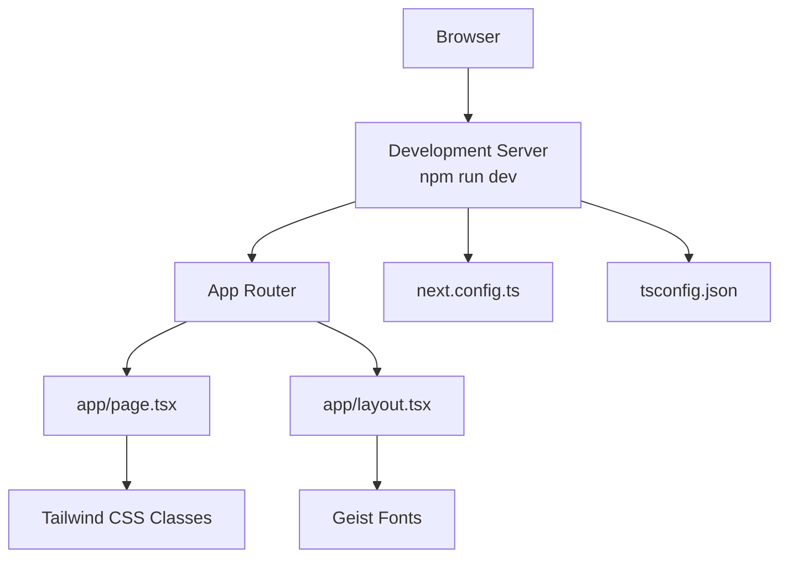

# Getting Started

<cite>
**Referenced Files in This Document**
- [README.md](file://frontend/README.md)
- [package.json](file://frontend/package.json)
- [page.tsx](file://frontend/app/page.tsx)
- [layout.tsx](file://frontend/app/layout.tsx)
- [next.config.ts](file://frontend/next.config.ts)
- [tsconfig.json](file://frontend/tsconfig.json)
</cite>

## Table of Contents
1. [Introduction](#introduction)
2. [Prerequisites](#prerequisites)
3. [Installation](#installation)
4. [Run the Development Server](#run-the-development-server)
5. [Edit the Main Page](#edit-the-main-page)
6. [Auto-Reload and Hot Refresh](#auto-reload-and-hot-refresh)
7. [Project Structure Overview](#project-structure-overview)
8. [Troubleshooting](#troubleshooting)
9. [Browser Compatibility Notes](#browser-compatibility-notes)
10. [Next Steps](#next-steps)

## Introduction
This guide helps you set up and run the Next.js landing page project locally. You will install dependencies, start the development server, edit the main page, and understand how auto-reload works during development. The project uses Next.js App Router with TypeScript and Tailwind CSS.

## Prerequisites
Before starting, ensure your environment meets these requirements:
- Node.js (LTS recommended). Use a version manager like nvm or fnm to manage versions if needed.
- A modern terminal or command prompt.
- Basic knowledge of HTML/CSS, JavaScript fundamentals, and React basics (components, JSX, props).
- A code editor such as VS Code.

Why these are needed:
- Node.js runs the development server and builds the app.
- HTML/CSS and React basics help you understand and modify the UI components.
- TypeScript is used in this project; familiarity with types will be helpful but not mandatory for initial setup.

[No sources needed since this section provides general guidance]

## Installation
Follow these steps to install dependencies:

1. Open your terminal and navigate to the frontend directory:
   - Command: `cd frontend`
2. Install dependencies using npm:
   - Command: `npm install`

What happens during installation:
- npm reads package.json and installs all runtime and development dependencies.
- It creates a lockfile to ensure consistent dependency versions across environments.

Optional package managers:
- If you prefer yarn, pnpm, or bun, you can use their respective commands to install dependencies. However, this guide focuses on npm.

**Section sources**
- [package.json:1-27](file://frontend/package.json#L1-L27)

## Run the Development Server
Start the development server after installing dependencies:

1. From the frontend directory, run:
   - Command: `npm run dev`
2. Wait for the server to compile and start.
3. Open your browser and visit:
   - URL: http://localhost:3000

What you should see:
- The default Next.js landing page rendered by the main page component.

Notes:
- The development server runs a fast build pipeline optimized for local development.
- If port 3000 is already in use, Next.js may prompt you to switch to another port.

**Section sources**
- [README.md:3-17](file://frontend/README.md#L3-L17)
- [package.json:5-10](file://frontend/package.json#L5-L10)

## Edit the Main Page
To customize the landing page:

1. Open the file:
   - Path: frontend/app/page.tsx
2. Modify the component to change text, layout, or add new elements.
3. Save the file and observe changes in the browser.

Key points:
- The main page exports a default React component that renders the landing page content.
- Styling uses Tailwind CSS utility classes defined in the component’s className attributes.
- Images are loaded via Next.js Image component for optimization.

Tip:
- Keep changes incremental and test frequently to avoid confusion when debugging.

**Section sources**
- [page.tsx:1-70](file://frontend/app/page.tsx#L1-L70)

## Auto-Reload and Hot Refresh
During development, Next.js automatically reloads your application when you save changes:

- File watchers detect modifications in source files.
- The development server recompiles affected modules quickly.
- The browser updates without requiring a manual refresh.

Best practices:
- Save frequently to see immediate feedback.
- If the UI does not update, try refreshing the browser once.
- Check the terminal for compilation errors or warnings.

**Section sources**
- [README.md:19-19](file://frontend/README.md#L19-L19)

## Project Structure Overview
The project follows the Next.js App Router structure:

- app/page.tsx: Main page component for the root route.
- app/layout.tsx: Root layout that sets global metadata and fonts.
- next.config.ts: Next.js configuration including Turbopack rules for CSS.
- tsconfig.json: TypeScript compiler options for the project.
- package.json: Scripts, dependencies, and devDependencies.

**Diagram sources**
- [page.tsx:1-70](file://frontend/app/page.tsx#L1-L70)
- [layout.tsx:1-30](file://frontend/app/layout.tsx#L1-L30)
- [next.config.ts:1-18](file://frontend/next.config.ts#L1-L18)
- [tsconfig.json:1-35](file://frontend/tsconfig.json#L1-L35)

**Section sources**
- [page.tsx:1-70](file://frontend/app/page.tsx#L1-L70)
- [layout.tsx:1-30](file://frontend/app/layout.tsx#L1-L30)
- [next.config.ts:1-18](file://frontend/next.config.ts#L1-L18)
- [tsconfig.json:1-35](file://frontend/tsconfig.json#L1-L35)

## Troubleshooting
Common issues and resolutions:

- Dependencies not installed:
  - Symptom: Running npm run dev fails with module not found errors.
  - Resolution: Run npm install again from the frontend directory.

- Port conflicts:
  - Symptom: Error indicating port 3000 is already in use.
  - Resolution: Stop other processes using port 3000 or let Next.js switch to another port.

- TypeScript errors:
  - Symptom: Build fails due to type mismatches.
  - Resolution: Fix type errors in your components or adjust tsconfig.json settings if necessary.

- CSS not applying:
  - Symptom: Tailwind styles do not render.
  - Resolution: Ensure Tailwind is configured and CSS files are imported correctly.

- Browser cache issues:
  - Symptom: Changes do not appear after saving.
  - Resolution: Hard refresh the browser (Ctrl+F5 or Cmd+Shift+R).

- Node.js version mismatch:
  - Symptom: Errors related to unsupported features or incompatible packages.
  - Resolution: Use an LTS Node.js version compatible with the project’s dependencies.

**Section sources**
- [package.json:1-27](file://frontend/package.json#L1-L27)
- [tsconfig.json:1-35](file://frontend/tsconfig.json#L1-L35)

## Browser Compatibility Notes
- Use a modern browser (Chrome, Edge, Firefox, Safari) for the best experience.
- Some advanced features rely on modern web standards supported by current browsers.
- If you encounter rendering issues, update your browser or disable experimental flags.

[No sources needed since this section provides general guidance]

## Next Steps
After successfully running the project:
- Explore the official Next.js documentation to learn about routing, data fetching, and deployment.
- Customize the landing page by editing app/page.tsx.
- Add new pages under the app directory following the App Router conventions.
- Configure Tailwind CSS further in globals.css or theme configuration if needed.

**Section sources**
- [README.md:23-37](file://frontend/README.md#L23-L37)