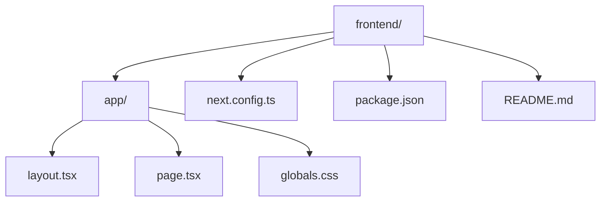
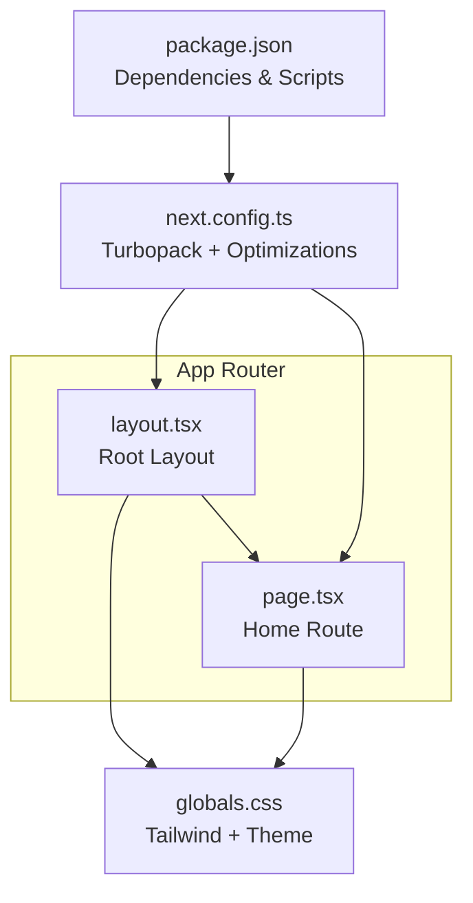
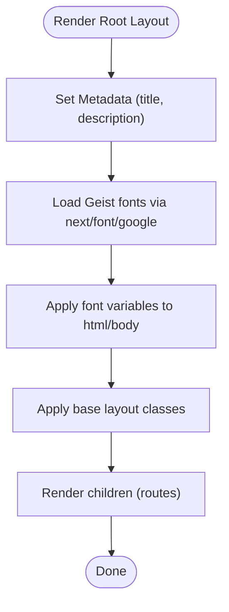
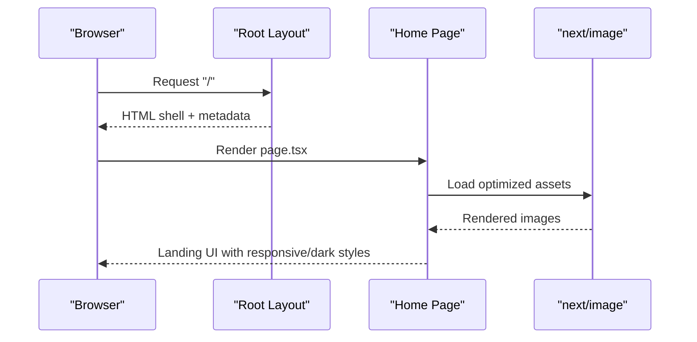
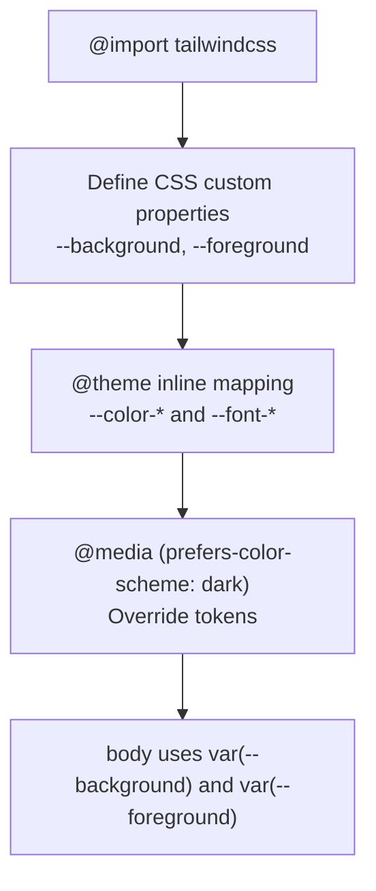
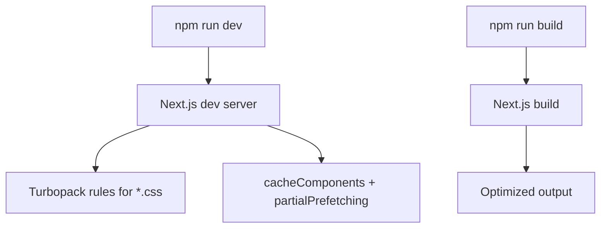
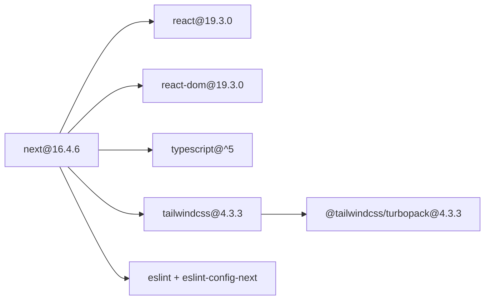

# Project Overview

<cite>
**Referenced Files in This Document**
- [README.md](file://frontend/README.md)
- [package.json](file://frontend/package.json)
- [next.config.ts](file://frontend/next.config.ts)
- [app/layout.tsx](file://frontend/app/layout.tsx)
- [app/page.tsx](file://frontend/app/page.tsx)
- [app/globals.css](file://frontend/app/globals.css)
</cite>

## Table of Contents
1. [Introduction](#introduction)
2. [Project Structure](#project-structure)
3. [Core Components](#core-components)
4. [Architecture Overview](#architecture-overview)
5. [Detailed Component Analysis](#detailed-component-analysis)
6. [Dependency Analysis](#dependency-analysis)
7. [Performance Considerations](#performance-considerations)
8. [Troubleshooting Guide](#troubleshooting-guide)
9. [Conclusion](#conclusion)

## Introduction
This project is a modern, responsive landing page template built with Next.js 16 and React 19. It follows the App Router pattern and uses Server Components by default to deliver fast, SEO-friendly pages. The template includes:
- TypeScript for type safety
- Tailwind CSS v4 for utility-first styling
- Geist fonts via next/font for optimized typography
- Dark mode support using CSS custom properties and Tailwind’s dark variant
- Turbopack integration for faster development builds

It is designed to be a clean starting point that you can customize quickly while leveraging Next.js best practices such as file-based routing, metadata, and component composition.

## Project Structure
The application uses the App Router directory structure under app/. The root layout defines global HTML structure, fonts, and theme variables, while the home page renders the landing content. Styling is centralized in globals.css and composed with Tailwind utilities.

**Diagram sources**
- [app/layout.tsx:1-30](file://frontend/app/layout.tsx#L1-L30)
- [app/page.tsx:1-70](file://frontend/app/page.tsx#L1-L70)
- [app/globals.css:1-27](file://frontend/app/globals.css#L1-L27)
- [next.config.ts:1-18](file://frontend/next.config.ts#L1-L18)
- [package.json:1-27](file://frontend/package.json#L1-L27)
- [README.md:1-37](file://frontend/README.md#L1-L37)

**Section sources**
- [app/layout.tsx:1-30](file://frontend/app/layout.tsx#L1-L30)
- [app/page.tsx:1-70](file://frontend/app/page.tsx#L1-L70)
- [app/globals.css:1-27](file://frontend/app/globals.css#L1-L27)
- [next.config.ts:1-18](file://frontend/next.config.ts#L1-L18)
- [package.json:1-27](file://frontend/package.json#L1-L27)
- [README.md:1-37](file://frontend/README.md#L1-L37)

## Core Components
- Root Layout (Server Component): Defines document-level metadata, imports Google fonts (Geist), applies font variables to html/body, and sets up base styles and theme tokens.
- Home Page (Server Component): Renders the landing page content using Tailwind utilities, including responsive layout, dark mode variants, and optimized images.
- Global Styles: Imports Tailwind v4, defines CSS custom properties for background and foreground colors, exposes them through @theme, and sets prefers-color-scheme based dark mode defaults.

Key responsibilities:
- Metadata and fonts are configured at the root layout level.
- Theme tokens and color schemes are defined in global styles.
- The page component composes UI with Tailwind classes and Next.js Image optimization.

**Section sources**
- [app/layout.tsx:1-30](file://frontend/app/layout.tsx#L1-L30)
- [app/page.tsx:1-70](file://frontend/app/page.tsx#L1-L70)
- [app/globals.css:1-27](file://frontend/app/globals.css#L1-L27)

## Architecture Overview
The application follows the App Router architecture:
- File-based routes under app/ map directly to URLs.
- layout.tsx provides shared UI and context for all routes.
- page.tsx represents the root route (/).
- Styling and theming are centralized in globals.css and extended via Tailwind utilities.
- Build-time optimizations include component caching and partial prefetching, with Turbopack rules for CSS processing.

**Diagram sources**
- [app/layout.tsx:1-30](file://frontend/app/layout.tsx#L1-L30)
- [app/page.tsx:1-70](file://frontend/app/page.tsx#L1-L70)
- [app/globals.css:1-27](file://frontend/app/globals.css#L1-L27)
- [next.config.ts:1-18](file://frontend/next.config.ts#L1-L18)
- [package.json:1-27](file://frontend/package.json#L1-L27)

## Detailed Component Analysis

### Root Layout (Server Component)
Responsibilities:
- Declares page metadata (title, description).
- Loads and configures Geist Sans and Mono fonts via next/font/google.
- Applies font variables to html and body, enabling Tailwind theme tokens to reference them.
- Sets up base layout classes for full-height and flex column structure.

**Diagram sources**
- [app/layout.tsx:1-30](file://frontend/app/layout.tsx#L1-L30)

**Section sources**
- [app/layout.tsx:1-30](file://frontend/app/layout.tsx#L1-L30)

### Home Page (Server Component)
Responsibilities:
- Renders the landing page content with responsive layout and dark mode variants.
- Uses next/image for optimized image loading with priority for the hero logo.
- Provides call-to-action links for deployment and documentation.

**Diagram sources**
- [app/page.tsx:1-70](file://frontend/app/page.tsx#L1-L70)

**Section sources**
- [app/page.tsx:1-70](file://frontend/app/page.tsx#L1-L70)

### Global Styles and Theme
Responsibilities:
- Imports Tailwind v4 and defines CSS custom properties for background and foreground colors.
- Exposes theme tokens via @theme for Tailwind to consume (e.g., --color-background, --font-sans).
- Implements system dark mode detection using prefers-color-scheme and updates theme tokens accordingly.

**Diagram sources**
- [app/globals.css:1-27](file://frontend/app/globals.css#L1-L27)

**Section sources**
- [app/globals.css:1-27](file://frontend/app/globals.css#L1-L27)

### Configuration and Tooling
- next.config.ts enables component caching and partial prefetching, and configures Turbopack to process CSS files with the Tailwind plugin.
- package.json declares dependencies for Next.js 16, React 19, Tailwind CSS v4, TypeScript, and related tooling.

**Diagram sources**
- [next.config.ts:1-18](file://frontend/next.config.ts#L1-L18)
- [package.json:1-27](file://frontend/package.json#L1-L27)

**Section sources**
- [next.config.ts:1-18](file://frontend/next.config.ts#L1-L18)
- [package.json:1-27](file://frontend/package.json#L1-L27)

## Dependency Analysis
The project relies on:
- next@16.4.6 for framework features (App Router, Server Components, metadata, etc.)
- react@19.3.0 and react-dom@19.3.0 for UI runtime
- tailwindcss@4.3.3 and @tailwindcss/turbopack@4.3.3 for styling and Turbopack integration
- typescript@^5 for type-safe development
- eslint and eslint-config-next for linting

**Diagram sources**
- [package.json:1-27](file://frontend/package.json#L1-L27)

**Section sources**
- [package.json:1-27](file://frontend/package.json#L1-L27)

## Performance Considerations
- Server Components: Default rendering strategy reduces client-side JavaScript and improves initial load performance.
- next/font: Optimizes font loading and avoids layout shifts by preloading and serving optimized font files.
- next/image: Optimizes image delivery with automatic sizing, lazy loading, and format selection; the hero image uses priority to prioritize critical rendering.
- Turbopack: Configured to accelerate development builds and CSS processing via the Tailwind plugin.
- Partial Prefetching and Component Caching: Enabled in configuration to improve navigation and rebuild performance.

Practical tips:
- Keep components small and colocated with their routes for better caching and tree-shaking.
- Prefer static or server-rendered content where possible to minimize client work.
- Use Tailwind utilities consistently to leverage incremental CSS generation.

[No sources needed since this section provides general guidance]

## Troubleshooting Guide
- Development server not starting: Ensure Node.js is installed and run npm run dev. Verify port 3000 availability.
- Tailwind styles not applied: Confirm @import "tailwindcss" exists in globals.css and that Turbopack rule for *.css is present in next.config.ts.
- Dark mode not switching: Check that prefers-color-scheme media query is present and that CSS variables are correctly overridden.
- Font issues: Verify next/font usage and that font variables are applied to html/body in the root layout.
- Build errors: Run npm run build to surface compilation issues; ensure TypeScript and ESLint configurations are aligned with your code.

**Section sources**
- [README.md:1-37](file://frontend/README.md#L1-L37)
- [next.config.ts:1-18](file://frontend/next.config.ts#L1-L18)
- [app/globals.css:1-27](file://frontend/app/globals.css#L1-L27)
- [app/layout.tsx:1-30](file://frontend/app/layout.tsx#L1-L30)

## Conclusion
This Next.js landing page template provides a fast, accessible, and customizable foundation. With the App Router, Server Components, Tailwind CSS v4, and Turbopack, it balances developer experience and production performance. You can extend it by adding new routes under app/, composing reusable components, and enhancing theming and interactivity as needed.

[No sources needed since this section summarizes without analyzing specific files]