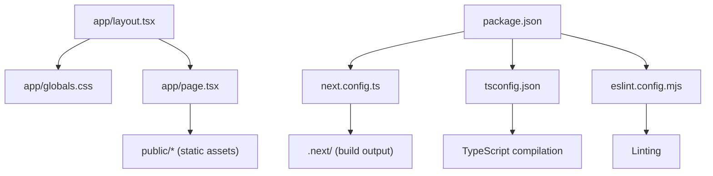
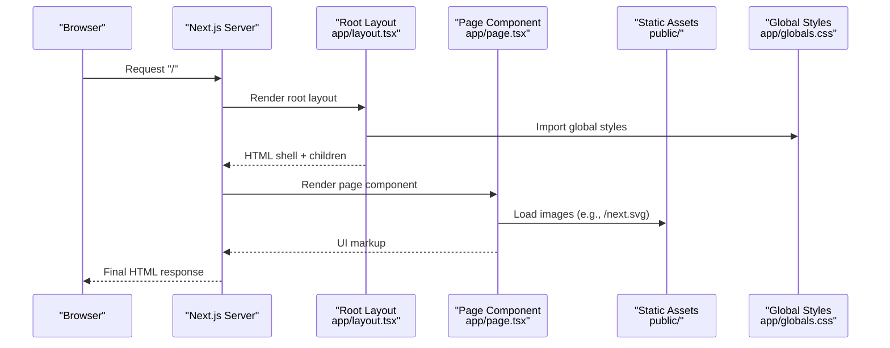
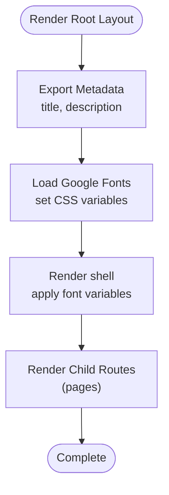
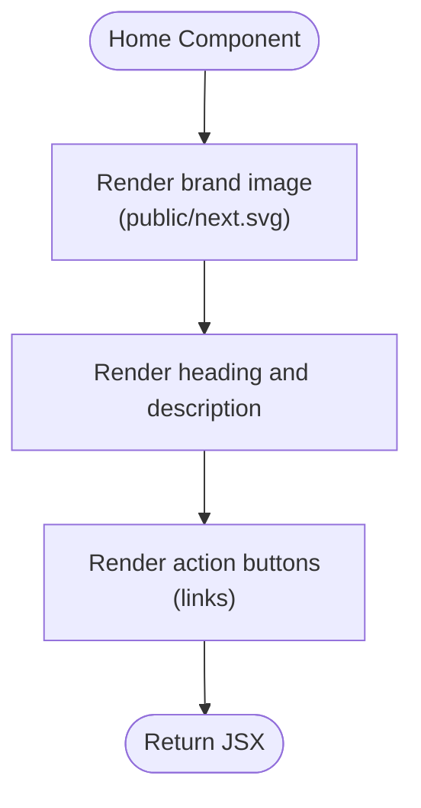
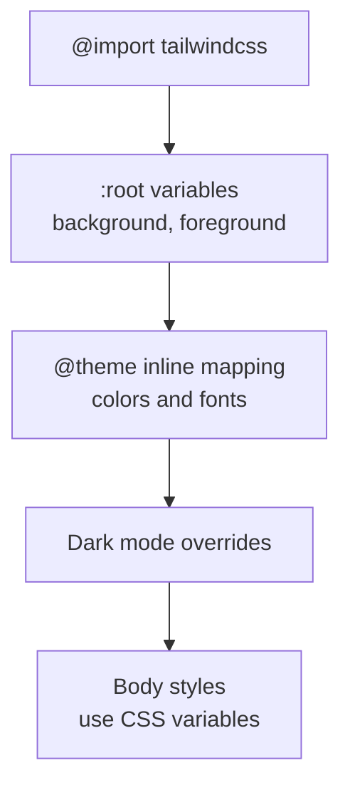
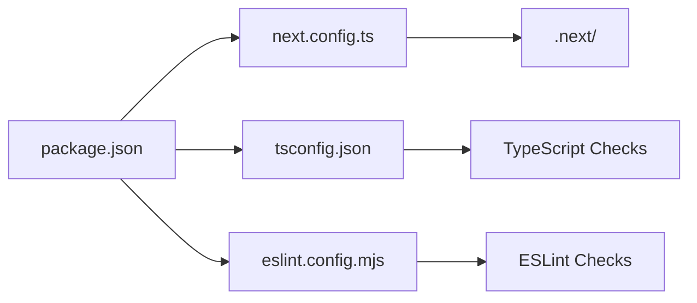

# Project Structure

<cite>
**Referenced Files in This Document**
- [layout.tsx](file://frontend/app/layout.tsx)
- [page.tsx](file://frontend/app/page.tsx)
- [globals.css](file://frontend/app/globals.css)
- [next.config.ts](file://frontend/next.config.ts)
- [tsconfig.json](file://frontend/tsconfig.json)
- [eslint.config.mjs](file://frontend/eslint.config.mjs)
- [package.json](file://frontend/package.json)
</cite>

## Table of Contents
1. [Introduction](#introduction)
2. [Project Structure](#project-structure)
3. [Core Components](#core-components)
4. [Architecture Overview](#architecture-overview)
5. [Detailed Component Analysis](#detailed-component-analysis)
6. [Dependency Analysis](#dependency-analysis)
7. [Performance Considerations](#performance-considerations)
8. [Troubleshooting Guide](#troubleshooting-guide)
9. [Conclusion](#conclusion)

## Introduction
This document explains the Next.js App Router project structure and how key files work together to render the landing page, configure fonts and theme variables, and optimize the build pipeline. It focuses on the app/ directory layout (layout.tsx, page.tsx, globals.css), static assets under public/, the .next/ build output, and configuration files including next.config.ts, tsconfig.json, and eslint.config.mjs.

## Project Structure
The project follows the Next.js App Router conventions:
- app/: Contains route segments and global styles.
  - layout.tsx: Root layout that wraps all pages with HTML shell, metadata, and global font/theme setup.
  - page.tsx: The root page component rendered at the application’s home route.
  - globals.css: Global CSS that imports Tailwind and defines theme variables for colors and fonts.
- public/: Static assets served as-is (e.g., images referenced by the landing page).
- .next/: Build artifacts generated by Next.js during development and production builds.
- Configuration files:
  - next.config.ts: Next.js build and runtime configuration, including Turbopack rules for CSS.
  - tsconfig.json: TypeScript compiler options and path aliases.
  - eslint.config.mjs: Linting configuration using Next.js ESLint presets.
  - package.json: Scripts and dependencies for running, building, and linting the app.

**Diagram sources**
- [layout.tsx:1-30](file://frontend/app/layout.tsx#L1-L30)
- [page.tsx:1-70](file://frontend/app/page.tsx#L1-L70)
- [globals.css:1-27](file://frontend/app/globals.css#L1-L27)
- [next.config.ts:1-18](file://frontend/next.config.ts#L1-L18)
- [tsconfig.json:1-35](file://frontend/tsconfig.json#L1-L35)
- [eslint.config.mjs:1-19](file://frontend/eslint.config.mjs#L1-L19)
- [package.json:1-27](file://frontend/package.json#L1-L27)

**Section sources**
- [layout.tsx:1-30](file://frontend/app/layout.tsx#L1-L30)
- [page.tsx:1-70](file://frontend/app/page.tsx#L1-L70)
- [globals.css:1-27](file://frontend/app/globals.css#L1-L27)
- [next.config.ts:1-18](file://frontend/next.config.ts#L1-L18)
- [tsconfig.json:1-35](file://frontend/tsconfig.json#L1-L35)
- [eslint.config.mjs:1-19](file://frontend/eslint.config.mjs#L1-L19)
- [package.json:1-27](file://frontend/package.json#L1-L27)

## Core Components
- Root Layout (app/layout.tsx)
  - Purpose: Provides the HTML shell, sets language and accessibility attributes, injects Google Fonts via CSS variables, and includes global styles.
  - Key responsibilities:
    - Define site-wide metadata (title and description).
    - Apply font variables to the html element.
    - Wrap child routes with a consistent body structure.
- Landing Page (app/page.tsx)
  - Purpose: Renders the main landing page UI, including branding image, headings, links, and call-to-action buttons.
  - Uses Next.js Image component for optimized asset delivery and references static SVGs from public/.
- Global Styles (app/globals.css)
  - Purpose: Imports Tailwind CSS and configures theme tokens for background/foreground colors and font families.
  - Supports dark mode through prefers-color-scheme media query.

**Section sources**
- [layout.tsx:15-29](file://frontend/app/layout.tsx#L15-L29)
- [page.tsx:1-70](file://frontend/app/page.tsx#L1-L70)
- [globals.css:1-27](file://frontend/app/globals.css#L1-L27)

## Architecture Overview
The Next.js App Router composes the root layout and the root page into a single rendered tree. The layout provides the document shell and global styles; the page renders the content. Static assets are served from public/ and referenced by components. Build-time optimizations are configured in next.config.ts, while TypeScript and ESLint ensure code quality and type safety.

**Diagram sources**
- [layout.tsx:1-30](file://frontend/app/layout.tsx#L1-L30)
- [page.tsx:1-70](file://frontend/app/page.tsx#L1-L70)
- [globals.css:1-27](file://frontend/app/globals.css#L1-L27)

## Detailed Component Analysis

### Root Layout (app/layout.tsx)
- Responsibilities:
  - Exports site metadata (title and description).
  - Loads Google Fonts and exposes them as CSS custom properties.
  - Applies font variables and utility classes to the html element.
  - Wraps child routes within a flex-based body layout.
- Integration points:
  - Imports globals.css to apply Tailwind and theme variables globally.
  - Serves as the parent for all route segments under app/.

**Diagram sources**
- [layout.tsx:15-29](file://frontend/app/layout.tsx#L15-L29)

**Section sources**
- [layout.tsx:1-30](file://frontend/app/layout.tsx#L1-L30)

### Landing Page (app/page.tsx)
- Responsibilities:
  - Renders the primary landing page UI.
  - Uses Next.js Image for performance-optimized images.
  - References static assets located in public/.
- Styling:
  - Uses Tailwind utility classes for layout, spacing, typography, and responsive design.
  - Leverages dark mode variants where applicable.

**Diagram sources**
- [page.tsx:1-70](file://frontend/app/page.tsx#L1-L70)

**Section sources**
- [page.tsx:1-70](file://frontend/app/page.tsx#L1-L70)

### Global Styles (app/globals.css)
- Responsibilities:
  - Imports Tailwind CSS.
  - Defines CSS custom properties for background and foreground colors.
  - Maps Tailwind theme tokens to CSS variables for fonts and colors.
  - Provides dark mode support via prefers-color-scheme.
- Impact:
  - Ensures consistent theming across the application.
  - Enables Tailwind utilities like bg-background and text-foreground.

**Diagram sources**
- [globals.css:1-27](file://frontend/app/globals.css#L1-L27)

**Section sources**
- [globals.css:1-27](file://frontend/app/globals.css#L1-L27)

### Static Assets (public/)
- Purpose: Hosts static files such as images referenced by the landing page (e.g., /next.svg, /vercel.svg).
- Behavior: Files placed here are served at their absolute paths without transformation.

**Section sources**
- [page.tsx:7-14](file://frontend/app/page.tsx#L7-L14)
- [page.tsx:48-54](file://frontend/app/page.tsx#L48-L54)

### Build Output (.next/)
- Purpose: Generated directory containing compiled assets, server bundles, and client-side chunks used during development and production.
- Managed by: Next.js build tooling based on next.config.ts and package.json scripts.

**Section sources**
- [next.config.ts:1-18](file://frontend/next.config.ts#L1-L18)
- [package.json:5-10](file://frontend/package.json#L5-L10)

## Dependency Analysis
The following diagram shows how configuration files influence the build and development workflow.

**Diagram sources**
- [package.json:1-27](file://frontend/package.json#L1-L27)
- [next.config.ts:1-18](file://frontend/next.config.ts#L1-L18)
- [tsconfig.json:1-35](file://frontend/tsconfig.json#L1-L35)
- [eslint.config.mjs:1-19](file://frontend/eslint.config.mjs#L1-L19)

**Section sources**
- [package.json:1-27](file://frontend/package.json#L1-L27)
- [next.config.ts:1-18](file://frontend/next.config.ts#L1-L18)
- [tsconfig.json:1-35](file://frontend/tsconfig.json#L1-L35)
- [eslint.config.mjs:1-19](file://frontend/eslint.config.mjs#L1-L19)

## Performance Considerations
- Font loading: Using Google Fonts via CSS variables ensures minimal layout shift and efficient rendering.
- Image optimization: Leveraging Next.js Image component improves loading performance and reduces bandwidth usage.
- Build optimizations: Enabling cacheComponents and partialPrefetching can improve runtime performance.
- CSS processing: Turbopack rule for *.css accelerates development iteration when working with Tailwind.

**Section sources**
- [layout.tsx:5-13](file://frontend/app/layout.tsx#L5-L13)
- [page.tsx:7-14](file://frontend/app/page.tsx#L7-L14)
- [next.config.ts:3-14](file://frontend/next.config.ts#L3-L14)

## Troubleshooting Guide
- Missing static assets: Ensure images referenced in page.tsx exist under public/ with correct filenames.
- Tailwind not applying: Verify globals.css imports Tailwind and that theme variables are correctly mapped.
- TypeScript errors: Confirm tsconfig.json settings match the project’s module resolution and include/exclude patterns.
- Linting issues: Review eslint.config.mjs to ensure Next.js ESLint presets are applied and ignores are appropriate.

**Section sources**
- [page.tsx:7-14](file://frontend/app/page.tsx#L7-L14)
- [globals.css:1-27](file://frontend/app/globals.css#L1-L27)
- [tsconfig.json:1-35](file://frontend/tsconfig.json#L1-L35)
- [eslint.config.mjs:1-19](file://frontend/eslint.config.mjs#L1-L19)

## Conclusion
This Next.js App Router project organizes the root layout, landing page, and global styles in a clear, maintainable structure. Configuration files provide robust build-time optimizations, type safety, and code quality checks. Understanding these relationships helps you extend the landing page, add new routes, and customize themes efficiently.