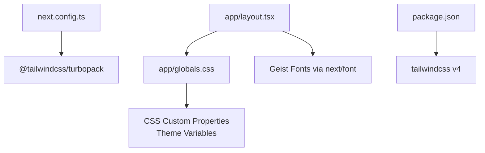
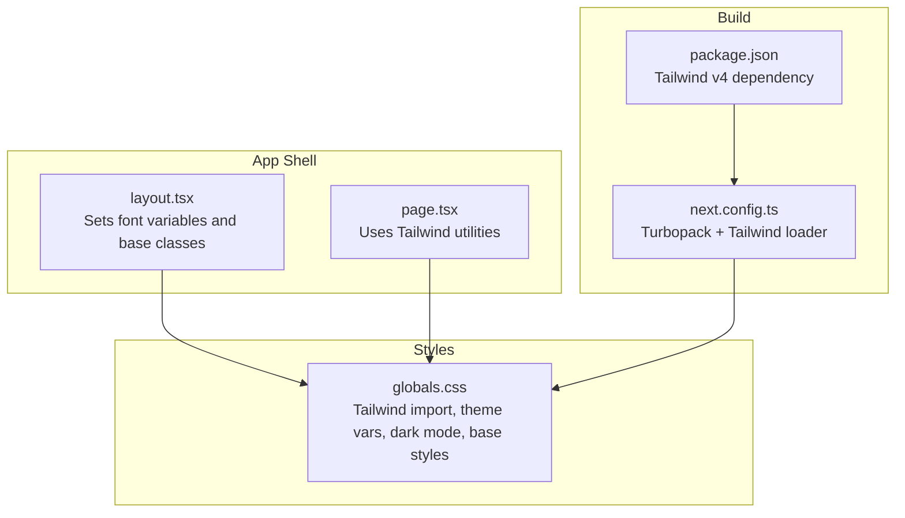
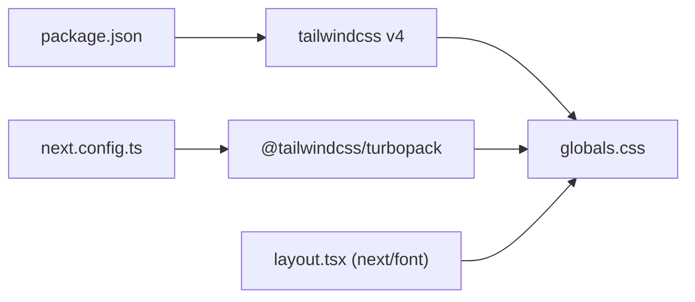

# Styling & Theming

<cite>
**Referenced Files in This Document**
- [globals.css](file://frontend/app/globals.css)
- [layout.tsx](file://frontend/app/layout.tsx)
- [next.config.ts](file://frontend/next.config.ts)
- [package.json](file://frontend/package.json)
- [README.md](file://frontend/README.md)
</cite>

## Table of Contents
1. [Introduction](#introduction)
2. [Project Structure](#project-structure)
3. [Core Components](#core-components)
4. [Architecture Overview](#architecture-overview)
5. [Detailed Component Analysis](#detailed-component-analysis)
6. [Dependency Analysis](#dependency-analysis)
7. [Performance Considerations](#performance-considerations)
8. [Troubleshooting Guide](#troubleshooting-guide)
9. [Conclusion](#conclusion)

## Introduction
This document explains the styling and theming system used in the project, focusing on:
- Tailwind CSS v4 integration and utility-first approach
- Global styles configuration with CSS custom properties for theming
- Dark mode via media queries
- Base styling rules
- Font optimization using next/font with Geist fonts
- Responsive design patterns and mobile-first approach
- How to extend the theme with custom colors, spacing, and typography
- Examples of adding new theme variables and implementing consistent components

## Project Structure
The styling-related files are organized as follows:
- Global styles and theme variables live in the app directory’s global stylesheet
- Root layout wires up font variables and applies base classes
- Next.js configuration enables Turbopack with Tailwind CSS loader
- Package manifest declares Tailwind CSS v4 and related tooling

**Diagram sources**
- [layout.tsx:1-29](file://frontend/app/layout.tsx#L1-L29)
- [globals.css:1-27](file://frontend/app/globals.css#L1-L27)
- [next.config.ts:1-18](file://frontend/next.config.ts#L1-L18)
- [package.json:11-24](file://frontend/package.json#L11-L24)

**Section sources**
- [globals.css:1-27](file://frontend/app/globals.css#L1-L27)
- [layout.tsx:1-29](file://frontend/app/layout.tsx#L1-L29)
- [next.config.ts:1-18](file://frontend/next.config.ts#L1-L18)
- [package.json:11-24](file://frontend/package.json#L11-L24)

## Core Components
- Tailwind CSS v4 is imported at the top of the global stylesheet, enabling the utility-first approach across the application.
- CSS custom properties define semantic tokens for background and foreground colors.
- The @theme block maps Tailwind theme tokens (colors and fonts) to CSS variables.
- Dark mode is implemented via a prefers-color-scheme media query that updates the CSS variables.
- The root layout injects Geist font variables into the HTML element and applies base layout classes.
- Next.js config integrates Tailwind CSS with Turbopack for fast builds and development.

Key responsibilities:
- globals.css: imports Tailwind, defines theme variables, dark mode, and base body styles
- layout.tsx: sets up font variables and base layout classes
- next.config.ts: configures Turbopack rule for CSS processing with Tailwind
- package.json: declares dependencies including Tailwind CSS v4

**Section sources**
- [globals.css:1-27](file://frontend/app/globals.css#L1-L27)
- [layout.tsx:1-29](file://frontend/app/layout.tsx#L1-L29)
- [next.config.ts:1-18](file://frontend/next.config.ts#L1-L18)
- [package.json:11-24](file://frontend/package.json#L11-L24)

## Architecture Overview
The styling architecture combines Tailwind utilities with CSS custom properties for theming and uses next/font for optimized font loading.

**Diagram sources**
- [layout.tsx:1-29](file://frontend/app/layout.tsx#L1-L29)
- [globals.css:1-27](file://frontend/app/globals.css#L1-L27)
- [next.config.ts:1-18](file://frontend/next.config.ts#L1-L18)
- [package.json:11-24](file://frontend/package.json#L11-L24)

## Detailed Component Analysis

### Tailwind CSS v4 Integration
- Tailwind is imported directly in the global stylesheet, which activates the framework without additional configuration files.
- The build pipeline uses Turbopack with a specific rule to process CSS through the Tailwind loader.
- The package manifest includes Tailwind CSS v4 and its Turbopack plugin.

Practical implications:
- Utility classes can be used throughout components immediately after importing the global stylesheet.
- Fast iteration during development due to Turbopack integration.

**Section sources**
- [globals.css:1-1](file://frontend/app/globals.css#L1-L1)
- [next.config.ts:7-14](file://frontend/next.config.ts#L7-L14)
- [package.json:17-24](file://frontend/package.json#L17-L24)

### Global Styles and Theme Variables
- CSS custom properties define semantic tokens for background and foreground colors.
- The @theme block maps Tailwind color tokens and font families to these CSS variables.
- Base body styles apply the theme variables and set a default font stack.

How it works:
- Components use Tailwind utilities like text and bg color classes that resolve to the mapped theme tokens.
- Changing the CSS variables updates the entire UI consistently.

**Section sources**
- [globals.css:3-13](file://frontend/app/globals.css#L3-L13)
- [globals.css:22-26](file://frontend/app/globals.css#L22-L26)

### Dark Mode Implementation
- Dark mode is enabled via a media query that targets the user’s preferred color scheme.
- Inside the media query, the CSS variables for background and foreground are overridden to provide a dark palette.

Behavior:
- When the OS or browser is set to dark mode, the variables update automatically, switching the theme without JavaScript.

**Section sources**
- [globals.css:15-20](file://frontend/app/globals.css#L15-L20)

### Base Styling Rules
- The body selector applies the background and foreground variables and sets a default sans-serif font stack.
- The root layout adds full-height constraints and antialiased rendering to ensure consistent baseline behavior.

Best practices:
- Keep base styles minimal and rely on utilities for component-level styling.
- Use CSS variables for any values that should be themeable.

**Section sources**
- [globals.css:22-26](file://frontend/app/globals.css#L22-L26)
- [layout.tsx:20-29](file://frontend/app/layout.tsx#L20-L29)

### Font Optimization with Geist Fonts
- The root layout imports Geist Sans and Mono from next/font/google and assigns CSS variable names to each.
- These variables are applied to the html element so they can be referenced by the theme mapping in the global stylesheet.
- The README confirms the project uses next/font for automatic optimization and loading of Geist fonts.

Benefits:
- Zero layout shift and optimal performance for fonts.
- Consistent typography across light and dark themes via CSS variables.

**Section sources**
- [layout.tsx:1-13](file://frontend/app/layout.tsx#L1-L13)
- [layout.tsx:20-29](file://frontend/app/layout.tsx#L20-L29)
- [README.md:21-22](file://frontend/README.md#L21-L22)

### Responsive Design Patterns and Mobile-First Approach
- With Tailwind CSS v4, responsive utilities are available out of the box.
- Follow a mobile-first pattern: start with base styles for small screens and add breakpoints for larger devices using Tailwind’s responsive prefixes.
- Use flexible layouts (flexbox/grid utilities) and relative units to ensure adaptability across devices.

Guidelines:
- Prefer stacking layouts vertically on small screens and switch to horizontal arrangements at larger breakpoints.
- Use fluid typography and spacing where appropriate to maintain readability and balance.

[No sources needed since this section provides general guidance]

### Extending the Theme
To extend the theme with custom colors, spacing, and typography:
- Add new CSS custom properties under :root for semantic tokens (e.g., brand colors, spacing scales).
- Map those variables into the @theme block so Tailwind can consume them as design tokens.
- Reference the new tokens in components using Tailwind utilities.

Example steps:
- Define a new CSS variable for a brand color.
- Add a corresponding token mapping in the theme block.
- Use the new color utility class in components.

For spacing and typography:
- Introduce CSS variables for spacing scale and typography sizes.
- Map them in the theme block to expose them as Tailwind tokens.
- Apply them via utilities in components.

**Section sources**
- [globals.css:3-13](file://frontend/app/globals.css#L3-L13)

### Implementing Custom Components with Tailwind Classes
- Build components by composing Tailwind utilities for layout, spacing, color, and typography.
- Keep component styles declarative and avoid custom CSS unless necessary.
- Leverage theme variables for colors and fonts to maintain consistency.

Tips:
- Group related utilities logically within className strings.
- Extract reusable patterns into small, focused components.

[No sources needed since this section provides general guidance]

### Maintaining Design Consistency
- Centralize all theme tokens in CSS variables and map them via @theme.
- Avoid hardcoding colors, spacing, or font sizes in components; always use utilities tied to theme tokens.
- Regularly audit components to ensure they follow the established patterns.

**Section sources**
- [globals.css:3-13](file://frontend/app/globals.css#L3-L13)

## Dependency Analysis
The styling system depends on:
- Tailwind CSS v4 for utilities and theme mapping
- Turbopack integration for CSS processing
- next/font for optimized font loading

**Diagram sources**
- [package.json:17-24](file://frontend/package.json#L17-L24)
- [next.config.ts:7-14](file://frontend/next.config.ts#L7-L14)
- [globals.css:1-1](file://frontend/app/globals.css#L1-L1)
- [layout.tsx:1-13](file://frontend/app/layout.tsx#L1-L13)

**Section sources**
- [package.json:17-24](file://frontend/package.json#L17-L24)
- [next.config.ts:7-14](file://frontend/next.config.ts#L7-L14)
- [globals.css:1-1](file://frontend/app/globals.css#L1-L1)
- [layout.tsx:1-13](file://frontend/app/layout.tsx#L1-L13)

## Performance Considerations
- Using next/font ensures fonts are optimized and loaded efficiently, minimizing layout shifts.
- Tailwind CSS v4 with Turbopack accelerates development and build times.
- Relying on utilities reduces custom CSS bloat and improves maintainability.

[No sources needed since this section provides general guidance]

## Troubleshooting Guide
Common issues and resolutions:
- Dark mode not applying:
  - Ensure the media query is present and correctly overrides the CSS variables.
  - Verify the browser/system preference is set to dark mode.
- Fonts not appearing or causing layout shift:
  - Confirm font variables are injected into the html element via next/font.
  - Check that the theme mapping references the correct variable names.
- Tailwind utilities not working:
  - Verify Tailwind is imported in the global stylesheet.
  - Ensure Turbopack CSS rule is configured in Next.js config.

**Section sources**
- [globals.css:15-20](file://frontend/app/globals.css#L15-L20)
- [layout.tsx:1-13](file://frontend/app/layout.tsx#L1-L13)
- [globals.css:1-1](file://frontend/app/globals.css#L1-L1)
- [next.config.ts:7-14](file://frontend/next.config.ts#L7-L14)

## Conclusion
The project adopts a modern, maintainable styling strategy:
- Tailwind CSS v4 provides a robust utility-first foundation.
- CSS custom properties and @theme enable scalable theming and dark mode.
- next/font optimizes typography with Geist fonts.
- Turbopack integration enhances developer experience and build performance.
Following the guidelines in this document will help you extend the theme, implement responsive designs, and keep the codebase consistent and performant.